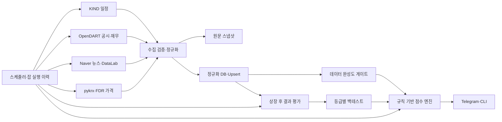

# Korea IPO Assistant 구현 이력 및 개선 기획서

> 현재 운영 알고리즘, 데이터 준비도와 다음 단계는 `MASTER_PLAN.md`가 우선합니다. 이 문서는 v1/v2 구현 이력과 상세 요구사항을 보존합니다.

## 1. 문서 정보

| 항목 | 내용 |
|---|---|
| 문서 상태 | Implemented v1.2 — 검증·이메일·참여 원장 반영 |
| 작성일 | 2026-07-19 |
| 대상 프로젝트 | `finance-korea-ipo-assistant` |
| 목표 릴리스 | v1.2.0 구현 완료 |
| 주요 사용자 | 국내 공모주 일정을 확인하고 청약 판단 자료를 정리하는 개인 사용자 |
| 운영 채널 | CLI, Telegram, Email, APScheduler, Docker Compose |

### 1.1 구현 완료 보고

2026-07-19 기준 IMP-01~30에 더해 단순 점수 v3, 청약 시작 전 point-in-time 검증, 역사 가격·성과 백필, 이메일, 실제 참여·분할 매도 원장과 재현 가능한 검증 산출물을 구현했다. 운영 DB는 `20260719_0012` head로 마이그레이션했다. 기존 백업 파일은 보존하며 신규 변경은 Alembic revision으로 관리한다.

| 검증 항목 | 결과 |
|---|---|
| 자동 테스트 | 511개 통과 |
| 전체 앱 커버리지 | statement 100.0%, branch 100.0% (5,353문장·1,386분기, omit 없음) |
| 정적 검사 | Ruff check/format 통과 |
| 마이그레이션 | 운영 DB `20260719_0012`; 빈 DB migration 회귀 테스트 통과 |
| 데이터 무결성 | 모든 정의된 자연키 중복 0그룹, 외래키 위반 0건 |
| 상태 무결성 | 상장 완료 활성 종목 0건 |
| 점수 이력 | 같은 입력은 멱등, 입력이 바뀌면 append-only revision 생성, 중복 0그룹 |
| 배포 구성 | Compose 구문, 명명 볼륨, 비루트, 읽기 전용 루트, 권한 제거 정적 계약 테스트 통과 |
| 의존성 | `pip check` 통과, 가격 수집 패키지 잠금 확인 |

현 데이터 기준 실제 IPO 27건 중 상장된 26건의 티커·공모가·D0/D1·성과는 확보했다. 다만 과거 수요예측·유통물량 피처와 청약 전 `rules-v3-simple` 점수–성과 완전 표본은 0건이므로 모델의 예측 성과는 아직 검증되지 않았다. 최소 30건 전에는 확률·기대수익을 운영 판단에 노출하지 않는다.

### 1.2 v1.1 요구사항별 완료 상태

| ID | 상태 | 구현·검증 근거 |
|---|---|---|
| IMP-01 | 완료 | 활성 상태 allowlist, 일일 상태 갱신, 상장 종목 제외 테스트 |
| IMP-02 | 완료 | 입력 지문 자연키, 동일 입력 멱등, 변경 입력 append-only, 중복 0건 |
| IMP-03 | 완료 | 수요예측·재무·뉴스·검색·가격·결과 공통 upsert와 자연키 테스트 |
| IMP-04 | 완료 | KIND→DART→이름·일정 버전 식별, 모호 레코드 분리와 검토 플래그 |
| IMP-05 | 완료 | 신고일·수요예측 기간·공모금액 포함 KIND 전 필드 fixture 대조 |
| IMP-06 | 완료 | 환불일·납입일 분리, 필드별 출처·검증 시각, 환불일 `미확정` 출력 |
| IMP-07 | 완료 | YAML 설정 검증·해시, 가중치 합 검증, 등급 경계 변경 테스트 |
| IMP-08 | 완료 | 7개 항목 합계 100점, 위험 패널티 최대 20점, 0점·100점 테스트 |
| IMP-09 | 완료 | 가중치 기반 완성도와 핵심 필드 게이트, 빈 데이터 `Insufficient Data` |
| IMP-10 | 완료 | 뉴스 품질 점수와 전역 위험 패널티 분리, 사건 단위 중복 제거 |
| IMP-11 | 완료 | 증권사 YAML·실제 과거 경쟁률 분위수, 가정 출처 및 증권사별 차이 테스트 |
| IMP-12 | 완료 | 수수료 선차감, 최대 수량 선적용, 단위 내림, 최소·증거금·비율 경곗값 |
| IMP-13 | 완료 | DART 표 항목 기반 추출과 필드별 근거·단위·파서·신뢰도 저장 |
| IMP-14 | 완료 | CFS→OFS, 계정코드 우선, 0·음수·전년도 0 상태, 재무 upsert |
| IMP-15 | 완료 | `collected`와 수동 `reviewed` 분리, 검토자·시각·근거·메모 저장 |
| IMP-16 | 완료 | 전체·등급별 표본·적중·평균·중앙값·손실 확률 및 소표본 경고 |
| IMP-17 | 완료 | Neutral 방향성 분모 제외와 ±5% 보조 적중률 |
| IMP-18 | 완료 | UTC 계산 시각 및 현재 정책상 청약 시작일 09:00 KST 이전 마지막 점수 선택 |
| IMP-19 | 완료 | XKRX 거래 캘린더, 실제 D0/D1/D3 날짜, 주말·대체공휴일 테스트 |
| IMP-20 | 완료 | KIND 전체 페이지, 250건 fixture, 빈·오류·열 변경 명시 실패 |
| IMP-21 | 완료 | 연결 재사용, 타임아웃, 지수 백오프+jitter, Retry-After, 비밀 마스킹 |
| IMP-22 | 완료 | 법인코드 일일 캐시, 정확명·종목코드 우선, 공시 전체 페이지·정정 계보 |
| IMP-23 | 완료 | 기간 종료까지 뉴스 페이지네이션, API·기간·중복 제거 건수 분리 |
| IMP-24 | 완료 | 회사명+IPO 문맥, 정식 hostname, 부정형 위험 제외, 재배포 제거 |
| IMP-25 | 완료 | 전체 파이프라인, IPO ID 전달, 성공·부분·실패·건너뜀 분류와 격리 재시도 |
| IMP-26 | 완료 | 채팅 allowlist, `/refresh` 사용자 allowlist, 공통 권한 검사와 보안 로그 |
| IMP-27 | 완료 | DB 작업 스레드 분리, 3,900자 분할, 입력 검증과 전역 오류 핸들러 |
| IMP-28 | 완료 | Alembic, SQLite FK, 고유 인덱스, orphan cascade, Numeric·UTC 모델 |
| IMP-29 | 완료 | 잠금 의존성, 서비스 분리, 명명 볼륨, 비루트, schema readiness, 컨테이너 권한 축소 |
| IMP-30 | 완료 | Python 3.9/3.11 CI, fixture·coverage, 잡 이력·부분 실패·운영 경보·상태 조회 |

### 1.3 다직군 2차 리뷰와 반영 결정

같은 코드베이스를 프론트엔드·제품 UX, 백엔드·데이터, 서버·SRE, QA·보안 관점에서 독립 검토했다. 여러 직군이 공통으로 지적한 데이터 오염·시점 누출·권한·운영 중단 위험을 우선 구현하고, 인프라 전환이 필요한 항목은 후속 릴리스로 분리했다.

| 직군 | 핵심 피드백 | 반영 결과 |
|---|---|---|
| 프론트엔드·제품 UX | KST 경계, 동명 IPO 임의 선택, 복수 주관사 자동 선택, 명령 발견성, 환불 일정 누락, 내부 JSON 노출 | KST clock, 엄격한 동명 거부, 증권사 명시 요구, `/start`·`/help`·명령 메뉴, 이벤트별 일정, 자연어 `/why` 적용 |
| 백엔드·데이터 | 배치가 회사명으로 재조회, 같은 세션 upsert 중복, 부분 `None` 덮어쓰기, 장 시작 전 점수 손실, 사람 검토 상태 강등, 실적·가정 출처 혼합 | 배치 IPO ID 전달, autoflush 및 WAL/busy timeout, patch semantics, 입력 지문 append-only 점수, reviewed 보호, actual 계보 분리 |
| 서버·SRE | Linux bind mount 쓰기 실패, `SELECT 1`만 하는 헬스체크, SQLite lock, 영구 pending 알림, 최신 잡 조회 오류, 컨테이너 권한 과다 | 명명 볼륨, Alembic head readiness, WAL/busy timeout, 5분 알림 lease, window query, read-only root·cap drop·no-new-privileges 적용 |
| QA·보안 | 단체방 `/refresh` 권한, 실제 실패를 성공으로 집계, Telegram POST 중복 가능성, 중첩 비밀정보 누출, 동명 종목 오선택 | 사용자 ID allowlist, 4상태 배치 분류, Telegram POST 무재시도, 재귀 redaction, 모호성 회귀 테스트 적용 |

#### 1.3.1 2차 개선 구현 명세

1. 모든 업무 기준일은 `IPO_TIMEZONE`의 로컬 날짜로 계산한다.
2. 사용자 이름 조회 결과가 둘 이상이면 후보 ID·청약일·시장을 제시하고 처리를 중단한다.
3. 내부 배치는 회사명이 아닌 불변 `ipo_id`를 전달한다.
4. 주관사가 둘 이상이면 `/calc`와 CLI 모두 증권사 지정을 요구한다.
5. SQLite는 WAL, 30초 busy timeout, FK, 정상 autoflush를 사용한다.
6. 수집 응답의 `None`은 기존 last-known-good 값을 지우지 않는다.
7. 배치 결과는 `success`, `partial`, `failed`, `skipped`로 분류한다.
8. 점수는 `(IPO, 날짜, 모델, 입력 지문)`으로 멱등이며 입력 변경은 새 revision으로 보존한다.
9. 결과 평가는 현재 정책상 청약 시작일 09:00 KST 이전의 마지막 revision만 사용한다. 청약일이 없는 과거 자료만 상장일을 fallback으로 쓴다.
10. 알림 예약은 5분 lease와 조건부 재획득으로 stale pending을 복구한다.
11. Telegram 전송 POST는 응답 불명 상태에서 자동 재시도하지 않는다.
12. 로그·잡 결과·알림 응답은 중첩 키와 Bearer 토큰까지 재귀적으로 마스킹한다.
13. 사람이 완료한 diligence review는 재수집으로 `collected`로 강등되지 않는다.
14. 배정 실제값의 출처·기록 시각을 추정 가정의 출처·갱신 시각과 분리한다.
15. 헬스체크는 DB 연결과 Alembic head 일치를 각각 검사하고 불일치 시 실패 종료한다.
16. Compose는 UID 10001이 소유 가능한 명명 볼륨과 최소 컨테이너 권한을 사용한다.
17. Telegram 명령 메뉴, 도움말, 이벤트 중심 일정, 자연어 근거와 KST 출처 시각을 제공한다.
18. `/refresh`는 채팅 허용목록과 별도의 개인 user ID 허용목록을 모두 통과하고 DB lease 기반 사용자별 60초 cooldown을 적용하며 실행 결과를 잡 이력에 기록한다.

#### 1.3.2 후속 개선 백로그

다음 항목은 단일 호스트 SQLite·개인용 Telegram 서비스라는 현재 범위를 넘어 인프라 또는 운영 정책 결정이 필요하므로 이번 수정에서 제외한다.

- 다중 인스턴스 운영 전 PostgreSQL 전환과 분산 scheduler leader lease 도입
- 영속 APScheduler job store, 선행 잡 의존성 gate, 장기 장애 catch-up 정책
- 알림 chunk별 outbox와 Telegram 자체 idempotency 부재를 보완하는 전달 확인 절차
- 소스별 일일 quota·우선순위 큐, 원본 보존 기간, 디스크 임계치 자동 정리
- 자동 SQLite online backup, 원격 보관, 정기 restore drill
- Prometheus/OpenTelemetry 외부 메트릭과 운영 대시보드

#### 1.3.3 2차 릴리스 게이트

- v1.1 당시 릴리스 품질 gate 통과; 현재는 511개 테스트와 전체 `app/` statement/branch 100%
- 운영 DB `20260719_0012`, FK 위반 0건
- 점수 입력 지문 누락 0건, 점수 revision·알림 이벤트 중복 0그룹
- `docker compose config --quiet`와 배포 계약 테스트 통과
- 실제 운영 이미지 빌드, 빈 DB 마이그레이션, 컨테이너 헬스체크 통과

## 2. 배경과 문제 정의

현재 시스템은 KIND 일정, OpenDART 공시·재무, 네이버 뉴스·검색 트렌드, 상장 후 가격을 한 데이터베이스에 연결하고 규칙 기반 점수와 텔레그램 알림을 제공하는 초기 구현체다. 핵심 기능의 골격은 갖춰졌지만, 반복 실행 시 데이터가 중복되고 상장 종목이 계속 활성 종목으로 남는 등 운영 데이터의 정확성을 훼손할 수 있는 문제가 있다.

2026-07-18 기준 코드와 로컬 SQLite 데이터를 점검한 결과는 다음과 같다.

- 자동 테스트 14개는 모두 통과했다.
- 같은 종목·날짜의 점수 스냅샷이 3~4개씩 생성된 사례가 확인됐다.
- 데이터베이스의 24개 종목 모두가 활성 종목 조회에 포함됐다.
- 점수 설정 파일의 가중치와 등급 기준이 실제 계산에 사용되지 않는다.
- 명목상 점수 항목 합계는 95점이며, 현재 구현상 실질 최대점은 91점이다.
- 스케줄러는 KIND 일정, 점수 계산, 메시지 발송만 자동화하고 DART·뉴스·가격·결과 평가는 자동 수행하지 않는다.
- 백테스트의 등급별 정확도 계산과 Neutral 처리에 논리 오류가 있다.

따라서 이번 개선의 핵심은 기능 추가보다 먼저 **데이터 무결성, 점수 신뢰도, 자동화 완결성, 운영 안전성**을 확보하는 것이다.

## 3. 목표와 비목표

### 3.1 목표

1. 동일 작업을 여러 번 실행해도 결과가 중복되지 않도록 한다.
2. 공모 일정과 상태를 실제 라이프사이클에 맞게 유지한다.
3. 점수, 추천 등급, 백테스트 결과를 재현 가능하고 설명 가능하게 만든다.
4. 일정 수집부터 상장 후 평가까지 운영 파이프라인을 자동화한다.
5. 텔레그램 봇을 개인용 서비스에 맞게 보호하고 장애를 관측할 수 있게 한다.
6. DB 마이그레이션, CI, 테스트, Docker 구성을 운영 가능한 수준으로 높인다.

### 3.2 비목표

- 증권사 로그인, 청약 신청, 주문 제출을 자동화하지 않는다.
- 점수나 등급을 확정 수익 예측 또는 투자 추천으로 표현하지 않는다.
- v1.0 범위에서 머신러닝 기반 매매 모델을 도입하지 않는다.
- 유료 데이터 소스 도입은 별도 의사결정 전까지 범위에서 제외한다.
- 다중 사용자 자산 관리나 포트폴리오 주문 기능을 구현하지 않는다.

## 4. 성공 지표

| 지표 | 현재 | 목표 | 측정 방법 |
|---|---:|---:|---|
| 동일 자연키 중복 행 | 존재 | 0건 | 일일 무결성 SQL 검사 |
| 상장 완료 종목의 활성 목록 포함 | 24건 확인 | 0건 | 상태별 활성 조회 테스트 |
| 필수 일정 필드 저장률 | 일부 필드 유실 | 수집값 100% 보존 | KIND fixture 대조 |
| 점수 재현성 | 설정과 코드 불일치 | 동일 입력·버전에서 100% 동일 | 회귀 테스트 |
| 낮은 완성도의 확정 등급 표시 | 가능 | 0건 | `Insufficient Data` 규칙 검사 |
| 자동 수집 파이프라인 성공률 | 미측정 | 최근 30일 95% 이상 | 잡 실행 이력 테이블 |
| 알림 중복 발송 | 방지 장치 없음 | 동일 이벤트 0건 | 알림 이벤트 고유키 검사 |
| 테스트 수 | 14개 | 핵심 경로 60개 이상 | CI 결과 |
| 테스트 커버리지 | 미측정 | 핵심 서비스 80% 이상 | `pytest-cov` |
| Telegram 비인가 접근 | 허용 가능 | 전부 차단 | 권한 테스트 |

## 5. 제품 원칙

1. **원본 우선:** 가공 지표에는 항상 출처, 수집 시각, 원문 해시를 연결한다.
2. **재실행 안전:** 수집과 계산은 여러 번 실행해도 동일 상태를 만든다.
3. **누락은 실패가 아니다:** 데이터 부족을 낮은 점수와 혼동하지 않고 완성도로 표현한다.
4. **시점 일관성:** 상장 전 예측에는 상장 후 생성된 정보를 절대 사용하지 않는다.
5. **설정 단일화:** 가중치, 증권사 규칙, 소스 제어는 설정 파일을 단일 진실 공급원으로 사용한다.
6. **사용자 통제:** 자동화는 수집·분석·알림까지만 수행하고 투자 행동은 사용자에게 남긴다.

## 6. 목표 아키텍처



## 7. 상태 모델

### 7.1 IPO 상태

| 상태 | 진입 조건 | 활성 점수 대상 | 다음 상태 |
|---|---|---:|---|
| `scheduled` | 청약 예정이며 수요예측 전 | 예 | `demand_forecast` |
| `demand_forecast` | 수요예측 진행 또는 결과 대기 | 예 | `subscription_open` |
| `subscription_open` | 오늘이 청약 시작일~종료일 | 예 | `subscription_closed` |
| `subscription_closed` | 청약 종료 후 상장 전 | 예 | `listed` |
| `listed` | 상장일 도달 | 아니오 | `evaluated` |
| `evaluated` | D3 가격과 결과 평가 완료 | 아니오 | `archived` |
| `withdrawn` | 철회·상장 취소 확인 | 아니오 | 종료 |
| `archived` | 운영 보존 상태 | 아니오 | 종료 |

`list_active_ipos()`는 `scheduled`, `demand_forecast`, `subscription_open`, `subscription_closed`만 반환한다. 가격 수집은 별도의 `list_price_due_ipos()`, 결과 평가는 `list_evaluation_due_ipos()`를 사용한다.

### 7.2 점수 상태

- `confidence_score < 70`: 추천 등급을 `Insufficient Data`로 표시한다.
- `confidence_score >= 70`: 점수에 따라 `Strong`, `Watch`, `Neutral`, `Avoid`를 표시한다.
- 점수 계산 시 `model_version`, `rules_hash`, `calculated_at`을 저장한다.
- 상장 전 예측 스냅샷은 `calculated_at < listing_market_open_at` 조건을 만족해야 한다.

## 8. 상세 요구사항 30개

### IMP-01. 활성 IPO 상태 조회 수정

- **우선순위:** P0
- **문제:** `listed` 상태가 활성 목록에서 제거되지 않아 이미 상장한 종목까지 매일 다시 점수화된다.
- **요구사항:** 명시적 허용 목록으로 활성 상태를 조회하고, 날짜가 변경되면 상태를 재계산하는 일일 잡을 추가한다.
- **완료 조건:** 상장일이 지난 종목이 `score_all_active()`에 포함되지 않고 상태 전이 테스트가 모두 통과한다.

### IMP-02. 점수 스냅샷 멱등성 확보

- **우선순위:** P0
- **문제:** 같은 종목과 날짜에 여러 점수 행이 생성된다.
- **요구사항:** `(ipo_id, score_date, model_version, input_fingerprint)` 고유 제약을 적용한다. 동일 입력 재계산은 기존 행을 반환하고 입력이 바뀌면 기존 예측을 덮지 않는 새 revision을 저장한다.
- **완료 조건:** 동일 입력을 10회 계산해도 revision은 1개이며, 상장 당일 장 시작 후 입력 변경이 장 시작 전 revision을 삭제하거나 갱신하지 않는다.

### IMP-03. 수집·평가 데이터 Upsert 표준화

- **우선순위:** P0
- **문제:** 수요예측, 재무, 뉴스, 검색, 가격, 결과 평가가 실행할 때마다 누적된다.
- **요구사항:** 공통 `upsert_*` 저장 함수를 만들고 아래 자연키를 적용한다.

| 테이블 | 자연키 |
|---|---|
| `demand_forecasts` | `ipo_id + receipt_no` |
| `financial_statements` | `ipo_id + fiscal_year + statement_type + account_code` |
| `financial_metrics` | `ipo_id + fiscal_year + source` |
| `news_metrics` | `ipo_id + window_start + window_end + source` |
| `search_trends` | `ipo_id + keyword_group + window_start + window_end + source` |
| `listing_prices` | `ipo_id + listing_date + source` |
| `outcome_evaluations` | `ipo_id + score_snapshot_id + evaluation_version` |

- **완료 조건:** 모든 수집 잡을 반복 실행한 통합 테스트에서 중복 행이 생성되지 않는다.

### IMP-04. IPO 식별 체계 강화

- **우선순위:** P0
- **문제:** 회사명과 청약 시작일만으로는 날짜 미정, 스팩 회차, 일정 변경을 안전하게 구분할 수 없다.
- **요구사항:** 식별 우선순위를 `kind_biz_no → dart_corp_code + receipt_no → normalized_name + schedule_version`으로 정의한다. 자동 병합이 모호하면 새 레코드를 만들고 검토 플래그를 남긴다.
- **완료 조건:** 청약일 미정 종목과 동일 회사의 재상장·스팩 회차가 서로 병합되지 않는다.

### IMP-05. KIND 전체 일정 필드 보존

- **우선순위:** P0
- **문제:** 신고일, 수요예측 기간, 공모금액이 파싱 후 DB에서 유실된다.
- **요구사항:** `report_filed_date`, `demand_start_date`, `demand_end_date`, `offer_amount_million`을 IPO 또는 일정 버전 테이블에 저장한다.
- **완료 조건:** KIND fixture의 모든 구조화 필드가 DB 조회 결과와 일치한다.

### IMP-06. 환불일과 납입일 분리

- **우선순위:** P0
- **문제:** 납입일을 환불일로 복사해 잘못된 알림이 발생할 수 있다.
- **요구사항:** 두 필드를 별도 수집하고 각 필드에 `source`, `verified_at`을 기록한다. 환불일이 없으면 `NULL`로 유지하고 메시지에 미확정으로 표시한다.
- **완료 조건:** 납입일만 존재하는 데이터에서 환불일이 자동 생성되지 않는다.

### IMP-07. 점수 설정 단일화

- **우선순위:** P0
- **문제:** YAML 설정과 실제 점수 코드가 분리돼 설정 변경이 반영되지 않는다.
- **요구사항:** 가중치, 구간, 등급 기준, 위험 패널티를 시작 시 검증한 설정 객체로 로드한다. 가중치 합이 100이 아니면 실행을 중단한다.
- **완료 조건:** YAML 값 변경만으로 점수와 등급 경계 테스트 결과가 바뀐다.

### IMP-08. 100점 점수 체계 재정의

- **우선순위:** P0
- **요구사항:** 기본 가중치를 다음과 같이 정의한다.

| 항목 | 배점 |
|---|---:|
| 기관 수요예측 | 25 |
| 재무 품질 | 15 |
| 밸류에이션 | 15 |
| 공모 구조 | 15 |
| 뉴스·검색 트렌드 | 10 |
| 예상 배정 효율 | 10 |
| 시장 환경 | 10 |
| 합계 | 100 |

위험 패널티는 합계에서 최대 20점까지 별도 차감한다. 모든 항목은 해당 최대점에 실제 도달 가능한 테스트 케이스를 가져야 한다.

- **완료 조건:** 위험 패널티가 없을 때 최소 0점과 최대 100점이 모두 생성 가능하다.

### IMP-09. 데이터 완성도와 추천 등급 분리

- **우선순위:** P0
- **문제:** 데이터가 없어서 받은 0점과 실제로 나쁜 0점을 구분하지 못한다.
- **요구사항:** 확보된 항목 가중치 합으로 `confidence_score`를 계산한다. 수요예측과 공모가를 핵심 필수 데이터로 지정하고, 완성도 70 미만 또는 핵심 데이터 누락 시 등급은 `Insufficient Data`로 표시한다.
- **완료 조건:** 빈 데이터 종목은 `Avoid`가 아니라 `Insufficient Data`로 출력된다.

### IMP-10. 뉴스 위험 이중 차감 제거

- **우선순위:** P0
- **문제:** 위험 키워드가 뉴스 점수와 전체 패널티에서 중복 반영된다.
- **요구사항:** 뉴스 점수는 관심도와 품질만 계산하고 위험 요소는 전역 위험 패널티에서 한 번만 계산한다. 같은 기사·같은 위험 사건의 중복도 제거한다.
- **완료 조건:** 위험 기사 1건이 단일 정의에 따라 한 번만 감점된다.

### IMP-11. 증권사별 배정 가정 도입

- **우선순위:** P1
- **문제:** 모든 종목에 신청자 30만 명과 고정 경쟁률을 적용한다.
- **요구사항:** `brokers.yaml`을 실제 기본값으로 사용하고 증권사·공모 규모·최근 경쟁률을 기반으로 보수/기준/낙관 가정을 만든다. 가정의 출처와 갱신일을 출력한다.
- **완료 조건:** 같은 종목이라도 증권사별 배정 예상치가 각 배정 물량과 규칙에 따라 달라진다.

### IMP-12. 청약 가능 수량 계산 보정

- **우선순위:** P1
- **요구사항:** 수수료를 제외한 가용 현금을 사용하고, 최대 청약수량을 먼저 적용한 뒤 증권사별 단위로 내림한다. 최소 수량, 증거금률, 균등·비례 배정 비율을 모두 검증한다.
- **완료 조건:** 경곗값, 최대 수량, 수수료 부족, 증거금률별 테스트가 통과한다.

### IMP-13. DART 수요예측 구조 기반 추출

- **우선순위:** P1
- **문제:** 문서 전체 텍스트 정규식은 잘못된 표의 숫자를 선택할 수 있다.
- **요구사항:** 문서 표 제목과 항목명을 기준으로 경쟁률, 확약률, 기관 수, 가격 분포를 추출한다. 필드별 원문 근거, 단위, 파서 버전, 신뢰도를 저장한다.
- **완료 조건:** 정상·정정·단위 변형 fixture에서 기대값을 추출하고 근거 위치를 조회할 수 있다.

### IMP-14. 재무 수집 정확도 및 중복 제거

- **우선순위:** P1
- **요구사항:** CFS 결과가 없으면 OFS로 fallback하고, 계정코드를 우선 매핑한다. 0 값을 누락으로 취급하지 않고, 전년도 0인 YoY는 별도 상태로 표시한다. 반복 실행은 upsert한다.
- **완료 조건:** 연결재무제표가 없는 기업, 0 매출, 음수 자본, 계정명 변형 fixture가 통과한다.

### IMP-15. 수집 완료와 사람 검토 완료 분리

- **우선순위:** P1
- **문제:** 원문이 수집됐다는 사실만으로 실사 검토가 완료될 수 있다.
- **요구사항:** `review_status`, `reviewed_by`, `reviewed_at`, `evidence_refs`, `review_note`를 저장한다. 자동 수집 상태는 `collected`, 사람이 확인한 상태만 `reviewed`로 정의한다.
- **완료 조건:** 원문만 존재하는 종목은 검토 완료로 표시되지 않는다.

### IMP-16. 백테스트 등급별 지표 수정

- **우선순위:** P0
- **요구사항:** 전체, Strong, Watch, Neutral, Avoid별 표본 수·적중률·평균 수익률·중앙값·손실 확률을 각각 계산한다. 표본 수가 10 미만이면 경고한다.
- **완료 조건:** 등급마다 서로 다른 필터 집합을 사용하며 수작업 계산 fixture와 일치한다.

### IMP-17. Neutral 예측 정책 정의

- **우선순위:** P0
- **요구사항:** Neutral은 방향성 적중률의 분모에서 제외한다. 별도로 `-5% ≤ D1 수익률 ≤ 5%`를 중립 적중으로 보는 보조 지표를 제공한다.
- **완료 조건:** Neutral이 자동으로 오답 처리되지 않고 전체 방향성 정확도도 오염시키지 않는다.

### IMP-18. 상장 후 정보 누출 방지

- **우선순위:** P0
- **요구사항:** 점수 스냅샷에 timezone-aware `calculated_at`을 저장하고 상장일 장 시작 전에 생성된 마지막 스냅샷만 평가에 사용한다. 정정공시 수집 시점도 피처 시점으로 보존한다.
- **완료 조건:** 상장 당일 09:00 이후 생성된 점수는 사전 예측 평가에 선택되지 않는다.

### IMP-19. 한국 거래일 캘린더 적용

- **우선순위:** P1
- **요구사항:** 실제 가격 행의 날짜를 저장하고 한국거래소 영업일 기준 D0/D1/D3를 결정한다. 상장 예정일과 실제 첫 거래일이 다르면 실제 거래일을 사용하되 차이를 기록한다.
- **완료 조건:** 주말, 공휴일, 임시 휴장일을 포함한 테스트가 통과한다.

### IMP-20. KIND 페이지네이션 및 파서 검증

- **우선순위:** P1
- **요구사항:** 전체 건수 또는 다음 페이지 존재 여부를 기준으로 모든 페이지를 수집한다. 빈 테이블, 열 개수 변경, 오류 페이지는 성공 0건이 아니라 명시적 실패로 처리한다.
- **완료 조건:** 250건 fixture에서 250건을 모두 수집하고 중복을 제거한다.

### IMP-21. 외부 API 공통 클라이언트 도입

- **우선순위:** P1
- **요구사항:** 연결 재사용, 지수 백오프, jitter, 타임아웃, 호출 간격, `Retry-After`, 최대 재시도를 공통 모듈에서 처리한다. 자격증명은 로그와 예외에서 마스킹한다.
- **완료 조건:** 429, 500, timeout fixture에서 정책대로 재시도하고 최종 실패를 잡 이력에 남긴다.

### IMP-22. DART 법인·공시 선택 강화

- **우선순위:** P1
- **요구사항:** 법인코드 ZIP을 일 단위로 캐시하고 정확한 회사명·종목코드를 우선 매칭한다. 공시 목록을 페이지네이션하고 원본→정정→최종 공시 계보를 구성한다.
- **완료 조건:** 동명·유사명 기업에서 올바른 법인코드를 선택하고 최종 정정공시를 사용한다.

### IMP-23. 네이버 뉴스 기간 기반 페이지네이션

- **우선순위:** P1
- **요구사항:** 게시일이 분석 시작일보다 오래될 때까지 페이지를 수집한다. API 전체 검색 건수와 기간 내 원본·중복 제거 건수를 분리 저장한다.
- **완료 조건:** 100건을 초과하는 fixture에서 기간 내 전체 기사 수가 정확하다.

### IMP-24. 뉴스 관련성·위험 분석 개선

- **우선순위:** P2
- **요구사항:** 종목명과 IPO 문맥이 모두 있는 기사를 우선하고 동명이인 제외 규칙을 둔다. URL은 정식 도메인으로 파싱한다. 위험 키워드는 기사별 존재 여부, 부정 표현, 사건 중복을 고려한다.
- **완료 조건:** 동명이인, 부정형 문장, 동일 기사 재배포 fixture에서 오탐과 중복이 제거된다.

### IMP-25. 전체 자동화 스케줄 완성

- **우선순위:** P0
- **요구사항:** 일정→공시→재무→뉴스→점수→알림→가격→결과 평가 순서와 선행조건을 정의한다. 실패한 종목만 재시도하고 한 종목의 실패가 전체 배치를 중단하지 않게 한다.
- **완료 조건:** 샘플 종목이 일정 수집부터 D3 평가까지 수동 CLI 없이 진행된다.

### IMP-26. Telegram 채팅 접근 제어

- **우선순위:** P0
- **요구사항:** 허용 채팅 ID 목록을 설정하고 모든 핸들러 진입 시 검사한다. 비인가 요청에는 민감한 존재 여부를 노출하지 않고 보안 로그만 남긴다.
- **완료 조건:** 허용·비허용 개인 채팅과 그룹 채팅 권한 테스트가 통과한다.

### IMP-27. Telegram 응답 및 오류 처리

- **우선순위:** P1
- **요구사항:** 동기 DB 작업은 스레드 또는 비동기 세션으로 분리한다. 긴 메시지는 항목 경계에서 여러 건으로 나누고, 금액·날짜·종목명 오류를 사용자 메시지로 변환한다. 전역 오류 핸들러를 등록한다.
- **완료 조건:** 4,000자 초과 응답이 유실 없이 전송되고 잘못된 `/calc` 입력이 봇을 중단시키지 않는다.

### IMP-28. DB 마이그레이션과 무결성

- **우선순위:** P0
- **요구사항:** Alembic baseline을 만들고 SQLite 외래키를 활성화한다. 고유 제약, `delete-orphan`, 필요한 인덱스를 추가한다. 금액은 `Numeric` 또는 정수 원 단위, 시각은 UTC aware datetime으로 저장한다.
- **완료 조건:** 빈 DB와 기존 DB 모두 마이그레이션되고, 고아 레코드와 자연키 중복이 차단된다.

### IMP-29. Docker 운영 구성 개선

- **우선순위:** P1
- **요구사항:** 런타임 의존성을 잠금 파일로 고정하고 가격 수집 패키지를 포함한다. `scheduler`와 `telegram-bot` 서비스를 분리하고 비루트 사용자, 헬스체크, graceful shutdown을 적용한다.
- **완료 조건:** `docker compose up`만으로 두 서비스가 시작되고 DB 헬스체크와 종료 신호를 정상 처리한다.

### IMP-30. CI·테스트·운영 관측성 구축

- **우선순위:** P0
- **요구사항:** CI에서 Ruff, pytest, coverage, 마이그레이션 테스트를 실행한다. KIND/DART/Naver/Telegram fixture를 네트워크 없이 검증한다. 잡별 시작·종료·성공·실패·처리 건수와 마지막 오류를 DB에 기록하고 운영 알림을 제공한다.
- **완료 조건:** PR 품질 게이트가 자동 실행되고 최근 잡 상태를 CLI와 Telegram에서 조회할 수 있다.

## 9. 데이터베이스 변경안

### 9.1 신규·변경 필드

| 대상 | 변경안 |
|---|---|
| `ipos` | 수요예측 기간, 신고일, 공모금액, 상태 변경 시각, 실제 상장일 추가 |
| `score_snapshots` | `confidence_score`, `calculated_at`, `rules_hash` 추가 |
| `demand_forecasts` | `receipt_no`, 필드별 근거 JSON, 파서 버전 추가 |
| `listing_prices` | D0/D1/D3 실제 거래일 추가 |
| `outcome_evaluations` | `evaluation_version`, 평가 기준 시각 추가 |
| 검토 데이터 | `review_status`, `reviewed_by`, `reviewed_at`, `evidence_refs` 추가 |
| 신규 `job_runs` | 잡명, 실행 ID, 시작·종료, 상태, 처리 건수, 오류 요약 저장 |
| 신규 `notification_events` | 채널, 이벤트키, 수신자, 발송 시각, 결과 저장 |

### 9.2 기존 데이터 마이그레이션

1. 운영 DB 백업과 SHA-256 체크섬을 생성한다.
2. Alembic baseline에 현재 스키마를 등록한다.
3. 자연키별 중복 그룹을 추출하고 최신·완전한 행을 보존한다.
4. 중복 점수는 `updated_at`, 설명 완성도, ID 순으로 대표 행을 선택한다.
5. 자동 복사된 환불일은 원본 증거가 없으면 `verification_required`로 표시한다.
6. 상태를 현재 일정 기준으로 다시 계산한다.
7. 고유 제약과 외래키를 마지막에 적용한다.
8. 마이그레이션 전후 행 수와 고아 레코드 검사를 보고서로 남긴다.

롤백은 원본 DB 백업 복원으로 수행하며, 검증이 끝날 때까지 원본을 삭제하지 않는다.

## 10. 목표 스케줄

| 시각 | 잡 | 대상 및 정책 |
|---|---|---|
| 07:00 | KIND 일정 수집 | 전체 페이지, 일정 변경 감지 |
| 07:10 | 상태 갱신 | 전체 미보관 IPO |
| 07:15 | DART 공시 수집 | 활성 IPO, 정정공시 우선 |
| 07:40 | 재무 수집 | 신규·변경 공시가 있는 IPO |
| 08:00 | 뉴스·검색 수집 | 30일 이내 청약 예정 IPO, 호출 한도 준수 |
| 08:20 | 점수 계산 | 완성도와 rules hash 확인 후 upsert |
| 08:30 | 일일 이벤트 알림 | 오늘 청약·환불·상장 이벤트 |
| 월요일 08:35 | 주간 요약 | 향후 7일 일정 |
| 16:30 | 가격 수집 | 상장일~D3 도래 종목 |
| 17:00 | 결과 평가 | 필요한 거래일 가격이 확보된 종목 |
| 매월 1일 09:00 | 월간 검증 | 등급별 백테스트와 표본 수 경고 |

모든 잡은 `max_instances=1`, `coalesce=true`, 적절한 `misfire_grace_time`을 설정한다. 동일 이벤트 알림은 `notification_events.event_key`로 중복 발송을 막는다.

## 11. Telegram 화면 요구사항

### 11.1 점수 응답

```text
[공모주 평가] 예시기업
종합 점수: 74.0 / Watch
데이터 완성도: 85%
모델: rules-v2

핵심 근거
- 기관 경쟁률: 1,240:1
- 의무보유확약: 18.2%
- 유통가능 비율: 27.1%

누락 데이터
- 시장 환경 중 최근 IPO 지수

※ 참고용 자동 분류이며 투자 추천이 아닙니다.
```

### 11.2 데이터 부족 응답

```text
[공모주 평가] 예시기업
등급: Insufficient Data
데이터 완성도: 45%
필수 누락: 수요예측 결과, 확정 공모가
다음 수집 예정: 2026-07-19 07:15 KST
```

### 11.3 운영 명령 추가

- `/status`: 마지막 잡 성공 시각과 실패 잡 표시
- `/sources 종목명`: 데이터별 출처와 갱신 시각 표시
- `/why 종목명`: 점수 상승·감점 근거 표시
- `/refresh 종목명`: 허용 사용자만 해당 종목 수집 재시도

## 12. 테스트 전략

### 12.1 단위 테스트

- 상태 전이와 활성 목록 필터
- 자연키 생성과 upsert
- 점수 가중치 합, 경곗값, 최대·최소점
- 데이터 완성도와 `Insufficient Data`
- 뉴스 위험 단일 감점
- 청약 단위, 최대 수량, 수수료, 증거금률
- Neutral 및 등급별 백테스트
- 상장 전 점수 시점 필터
- 한국 거래일 계산
- Telegram 권한과 입력 검증

### 12.2 수집기 계약 테스트

- KIND 다중 페이지 및 열 변경 fixture
- DART 원본·정정공시와 CFS/OFS fixture
- Naver 100건 초과, 429, 빈 결과 fixture
- pykrx/FDR 날짜 불일치와 fallback fixture
- 외부 API 응답은 비밀 값이 포함되지 않은 고정 fixture로 저장한다.

### 12.3 통합 테스트

1. 빈 DB에 일정 수집부터 점수 계산까지 실행한다.
2. 같은 파이프라인을 다시 실행해 행 수가 증가하지 않는지 확인한다.
3. 날짜를 상장 전·청약 중·상장 후로 이동해 상태와 대상 잡을 검증한다.
4. D3 가격을 입력해 결과 평가와 백테스트를 검증한다.
5. 기존 DB 복사본에 마이그레이션을 적용하고 무결성 SQL을 실행한다.

## 13. 구현 단계와 릴리스 계획

### Phase 1 — 데이터 정확성 기반, v0.2.0

- 대상: IMP-01~10, IMP-16~18, IMP-28
- 결과물: 상태 모델, upsert, DB migration, rules-v2, 정확한 백테스트
- 릴리스 게이트: 기존 DB 마이그레이션 리허설 성공 및 P0 테스트 통과

### Phase 2 — 수집·계산 정확도, v0.3.0

- 대상: IMP-11~15, IMP-19~24
- 결과물: 증권사별 배정, 구조 기반 DART, 전체 페이지 수집, 거래일 캘린더
- 릴리스 게이트: 고정 fixture 계약 테스트와 외부 샌드박스 검증 통과

### Phase 3 — 운영 자동화, v0.4.0

- 대상: IMP-25~27, IMP-30
- 결과물: 완전한 스케줄 파이프라인, Telegram 권한, 잡 이력과 운영 상태 조회
- 릴리스 게이트: 7일 연속 로컬 또는 스테이징 스케줄 성공률 95% 이상

### Phase 4 — 배포 안정화, v1.0.0

- 대상: IMP-29 및 전체 회귀 검증
- 결과물: 잠금된 의존성, 분리된 Docker 서비스, 백업·복구 절차
- 릴리스 게이트: 새 환경에서 문서만으로 설치·기동·복구 가능

## 14. 예상 일정

| 주차 | 주요 작업 |
|---|---|
| 1주차 | Alembic baseline, 상태 모델, 중복 정리 스크립트 |
| 2주차 | rules-v2, 완성도, 백테스트 수정, P0 테스트 |
| 3주차 | KIND·DART 페이지네이션과 구조 파서 |
| 4주차 | 재무·뉴스·가격 수집 정확도, 배정 계산 개선 |
| 5주차 | 전체 스케줄 파이프라인, Telegram 권한·오류 처리 |
| 6주차 | Docker, CI, 잡 관측성, 마이그레이션 리허설, 문서화 |

일정은 1인 개발 기준의 초안이며, 외부 API fixture 확보와 실제 공시 형식 변형 수에 따라 조정한다.

## 15. 위험과 대응

| 위험 | 영향 | 대응 |
|---|---|---|
| KIND HTML 구조 변경 | 일정 수집 중단 또는 잘못된 필드 | 열 헤더 검증, 0건 이상 탐지, 원문 저장 |
| DART 정정공시 다수 | 오래된 수치 사용 | 공시 계보와 최종본 선택 규칙 |
| API 호출 제한 | 뉴스·검색 누락 | 호출 예산, 백오프, 종목 우선순위 큐 |
| 기존 DB 중복 정리 오류 | 데이터 손실 | 백업, dry-run 보고서, 롤백 검증 |
| 점수 v2 분포 변화 | 과거 등급과 직접 비교 어려움 | 모델 버전 분리, 버전별 백테스트 |
| 소표본 백테스트 | 과도한 결론 | 표본 수 경고, 신뢰구간, 등급별 최소 표본 |
| Telegram 토큰 노출 | 비인가 접근 | 채팅 허용 목록, 토큰 교체 절차, 로그 마스킹 |
| 외부 패키지 변경 | 운영 중 런타임 장애 | 잠금 파일, CI 호환성 테스트, 버전별 이미지 |

## 16. 완료 정의

각 개선 항목은 다음 조건을 모두 충족해야 완료로 처리한다.

- 요구사항과 완료 조건을 만족하는 자동 테스트가 있다.
- 반복 실행과 부분 실패 후 재실행이 안전하다.
- 데이터 출처와 계산 버전을 조회할 수 있다.
- 마이그레이션이 기존 데이터 복사본에서 검증됐다.
- 사용자 메시지에 데이터 기준 시각과 누락 상태가 표시된다.
- 로그에 토큰, API 키, 전체 DB 접속 비밀번호가 노출되지 않는다.
- README의 설치, 실행, 스케줄, 제한사항이 실제 동작과 일치한다.
- 투자 추천이 아니라는 고지가 사용자 출력에 유지된다.

## 17. 우선 실행 순서

구현 착수 순서는 다음과 같다.

1. IMP-28 DB 마이그레이션 기반 생성
2. IMP-01~06 상태·식별·upsert·일정 필드 수정
3. IMP-07~10 점수 체계와 완성도 수정
4. IMP-16~18 백테스트 및 시점 누출 수정
5. IMP-25 자동화 파이프라인 연결
6. IMP-11~15, IMP-19~24 수집·분석 정확도 개선
7. IMP-26~27 Telegram 운영 안전성 개선
8. IMP-29~30 배포·CI·관측성 완성

이 순서는 새 스키마 위에서 데이터 정확성을 먼저 확보한 뒤 수집 범위와 운영 자동화를 확장하기 위한 것이다.
