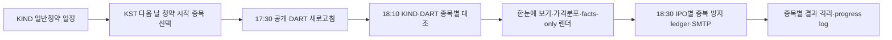

# IPO Assistant 7월 전체 목록·과거 근거·이메일 v3 개선 계획

- 기준일: 2026-07-19 KST
- 상태: `FACTS_V3_SENT / D1_PER_IPO_V3_IMPLEMENTED / NEXT_DUE_SEND_PENDING / HISTORICAL_GATE_BLOCKED` — 기존 7월 월간 facts v3 발송 이력은 보존하고, 일반청약 D-1 종목별 발송·상단 요약·가격분포 차트의 코드·회귀·Docker 검증은 완료했다. 2026-07-20 청약 시작 대상은 0건이어서 실제 D-1 SMTP·inbox 검수는 다음 대상일까지 대기하며, 엄격 과거 표본은 0/30이라 추천·확률은 계속 비활성이다.
- 대상 수신자: `dummy1.kim@gmail.com` 단일 고정
- 목적: 월 전체 IPO 모집단은 감사 화면으로 누락 없이 보존하면서, 실제 알림은 일반청약 시작 D-1에 종목별로 분리하고 확인된 사실·과거 관측·가정·결측을 구분해 청약 검토 근거를 이메일 안에서 제공
- 관련 문서: [MASTER_PLAN](../MASTER_PLAN.md), [IMPROVEMENT_PLAN](../IMPROVEMENT_PLAN.md), [COVERAGE_100_LOG](../COVERAGE_100_LOG.md)
- 이 문서는 이후 구현·데이터 보강·실제 수신 검수의 단일 진행 원장으로 계속 갱신한다.

## 1. 결론과 제품 원칙

현재 이메일은 일정 알림으로는 동작하지만, IPO 판단 보조 제품으로는 부족하다. 월 전체 모집단을 만들지 않고 청약 종료·상장 완료 종목을 판단 카드에서 제거하며, 실제 수요예측·일반청약 경쟁률·유통물량·재무·시장 근거가 운영 DB에 없다. 따라서 현재 상태에서 점수나 추천을 더 강조하면 정보가 늘어나는 것이 아니라 불확실성을 감추게 된다.

개선 순서는 다음으로 고정한다.

1. **전체성 우선**: 판단 가능 여부와 무관하게 7월에 관련 이벤트가 있는 모든 IPO를 한 번씩 노출한다.
2. **사실 우선**: 일정·공모가·모든 주관사·상장 후 실제 반응 등 확인된 사실부터 보여 준다.
3. **결측 공개**: 기관 경쟁률처럼 없는 값은 `0`이나 기본 가정으로 채우지 않고 `미수집`, `공시 전`, `충돌` 등 정확한 상태를 표시한다.
4. **시점 보존**: 청약 당시 알 수 없었던 사후 데이터를 과거 판단 근거로 사용하지 않는다.
5. **근거 단계화**: 현재 26건의 상장 결과는 시장 기초분포로만 사용하고, 시점이 검증된 사전 피처를 복원한 뒤에만 유사 IPO 근거로 승격한다.
6. **메일 자체 완결성**: 핵심 근거는 외부 페이지를 열지 않아도 HTML과 plain text 본문에서 확인할 수 있어야 한다. 출처 링크는 검증용으로 추가한다.
7. **검증 전 추천 금지**: 누수 없는 완전 표본이 최소 30건이 되기 전에는 미래 확률·기대수익·청약 추천을 노출하지 않는다. 장기 목표는 최근 24개월 또는 100건 이상의 시점 검증 표본이다.
8. **종목별 D-1 전달**: 자동 이메일은 상장일이 아니라 일반청약 시작일의 전날(KST 달력일) 18:30에 IPO별 한 통으로 보낸다. 같은 날 N개가 대상이면 N통이며 한 종목 실패가 나머지를 막지 않는다.
9. **분포 원자료 보존**: 기관 가격분포의 참여기관 수와 신청수량은 서로 다른 척도로 보여 주고, 가격 미제시는 별도 구간으로 둔다. 원자료 합계가 100%와 다르다는 이유로 강제 정규화하지 않는다.

현재 구현에서 먼저 제공해야 할 정상 fallback은 기존 v2 일정 메일이 아니라 **종목별 v3 facts-only**다. 역사 근거 계산에 실패해도 D-1 대상 종목의 확인된 사실은 발송할 수 있어야 한다. 월 전체 목록은 모집단·과거 자료 감사용 preview로 계속 보존하되 예약 발송 단위로 사용하지 않는다.

## 2. 사용자에게 보장할 정보 계약

개선 후 이메일은 다음을 보장한다.

- 월 전체 IPO는 상태와 데이터 완성도에 관계없이 모두 나온다.
- 청약 예정·진행·종료, 상장 대기·완료, 일정 연기, 철회·취소를 숨기지 않고 상태로 표시한다.
- 회사별로 수요예측일, 청약일, 환불일, 납입일, 예정·실제 상장일, 공모가 밴드·확정가, 공모 규모, 모든 주관사를 표시한다.
- 기관 수요예측 경쟁률·참여기관 수·의무보유확약·가격분포와 증권사별 일반청약 경쟁률·신청자 수·배정 물량을 서로 다른 사실로 표시한다.
- 공모 구조, 재무·밸류에이션, 당시 시장 국면, 뉴스·검색 관심도, 상장 후 D0/D1/D3 반응을 구분한다.
- 모든 비어 있지 않은 값에는 출처와 기준시각이 연결된다.
- 모든 빈 값에는 `공시 전`, `미수집`, `수집 실패`, `출처 충돌`, `해당 없음` 중 하나의 이유가 있다.
- 실제값, 추정 시나리오, 사후 관측값은 같은 색·라벨·필드로 표현하지 않는다.
- 숫자가 없다는 이유로 종목 자체를 이메일에서 제거하지 않는다.
- 자동 발송 메일 한 통에는 IPO 하나만 포함하고, 본문 맨 위에 `한눈에 보기`를 둔다.
- 기관 가격분포는 공모가 밴드 대비 구간, 참여기관 수·비중, 신청수량·비중, 정확한 합계, 출처, 기준시각을 함께 표시한다.
- 가격 미제시 건은 밴드 구간에 합치지 않으며, 원자료 비율 불일치를 숨기기 위한 강제 정규화를 하지 않는다.

## 3. 현재 운영 데이터 기준선

### 3.1 DB와 계보

아래는 2026-07-19 최종 구현·백필·발송 뒤 운영 SQLite `data/ipo.db`를 다시 집계한 결과다. 초기 감사값은 이 문서의 진행 로그에 보존한다.

| 항목 | 현재 값 | 판단 |
|---|---:|---|
| 전체 IPO | 120 | 실데이터 119 + 합성 샘플 `ABC테크` 1; 운영 메일의 sample 혼입 0 |
| 2026년 7월 이벤트 실 IPO | 4 | KIND 공모 4 · 성숙한 KIND 신규상장 3/3 · DART 계보 4, 이름 차이 0 |
| 공식 원문 스냅샷 | 189 | KIND 공모 3 · KIND 신규상장 1 · 공개 DART 185 |
| IPO 연결 source document | 153 | KIND 119 · 공개 DART 34 |
| append-only field observation | 1,423 | 일정·공모·기관·일반청약·구조·재무·시가총액과 가격분포 0값 교정 포함 |
| 월간 universe snapshot | 16 | 최신 7월 core 4 모두 `cross_checked` |
| 데이터 품질 이슈 | open 0 · resolved 15 | 현재 발송을 막는 미해결 공식 대조 gap 없음 |
| 이메일 감사 원장 | event 5 · content artifact 2 | canary와 교정 최종본의 subject/text/html/hash 보존 |
| 엄격 검증 완전 표본 | 0/30 | `validation_ready=false` |
| 운영 `rules-v3-simple` 사전 점수 | 0 | 확률·기대수익·추천 불가 |

최종 월간 대조는 KIND 공모진행현황의 4개와 DART 문서 계보 4개가 일치하고, 기준일에 이미 상장된 3개는 KIND 신규상장 결과 3개와 일치한다. 7/24 상장 예정인 에이치엘지노믹스는 아직 신규상장 결과에 없어야 정상이며 `expected_listing_names`에서도 제외된다. 이 조건을 모두 만족한 경우만 발송 job이 `cross_checked`를 통과하도록 강제했다.

### 3.2 2026년 7월 공식 대조 전체 목록

월간 합집합 정의를 현재 DB에 적용하면 실 IPO는 아래 4건이다.

| IPO | 7월 포함 이유 | 전체 일정 | 확정 공모가 | 주관사 | 현재 확보된 실제 결과 |
|---|---|---|---:|---|---|
| 매드업 | 7/1 상장 | 수요 6/12~18 · 청약 6/23~24 · 환불/납입 6/26 · 상장 7/1 | 8,000원 | 미래에셋증권 | D0 시초 +178.12% · D0 종가 +26.00% · D1 0.00% · D3 -12.12% |
| 레몬헬스케어 | 7/6 상장 | 수요 6/15~19 · 청약 6/24~25 · 납입 6/29 · 상장 7/6 | 10,000원 | KB증권 | D0 시초 +65.60% · D0 종가 -6.00% · D1 +22.20% · D3 -1.50% |
| 레메디 | 7/1~2 청약, 7/13 상장 | 수요 6/17~23 · 청약 7/1~2 · 납입 7/6 · 상장 7/13 | 20,700원 | KB증권 | D0 시초 +48.55% · D0 종가 +6.28% · D1 -15.65% · D3 -36.23% |
| 에이치엘지노믹스 | 7/2~8 수요, 7/13~14 청약, 7/24 상장 예정 | 수요 7/2~8 · 청약 7/13~14 · 납입 7/16 · 상장 예정 7/24 | 21,500원 | KB증권, IBK투자증권 | 상장 전이므로 정상적으로 `대기` |

코호트별로 보면 수요예측 기간이 7월과 겹치는 종목은 1개, 청약 기간이 겹치는 종목은 2개, 납입일은 2개, 예정·실제 상장일은 4개다. 이메일의 `7월 전체`는 이 중 하나만 고르는 것이 아니라 **모든 관련 이벤트의 합집합 4개**를 뜻한다.

환불일의 trusted completeness는 여전히 0/4다. 매드업의 기존 값은 `legacy_unverified`, 나머지 3개는 `미수집`으로 표시해 납입일을 환불일로 복사하지 않는다. 상장 완료 3개는 KIND 신규상장 이름·날짜 집합으로 별도 검증했지만, 상세 카드의 `실제 상장` 필드는 현재 current-row 값이라 `legacy_unverified` 라벨을 유지한다. 예정 상장일과 월 전체성 대조는 공식 KIND 근거다.

### 3.3 판단 근거 완성도

| 근거 | 7월 4개 | 전체 실 IPO 27개 | 현재 사용 가능 여부 |
|---|---:|---:|---|
| 수요·청약·납입·예정 상장 일정 | 4/4 | 119/119 KIND 문서 | 공식 원문·as-of 연결 완료 |
| 확정 공모가·공모금액 | 4/4 | 119개 KIND 계보 + 7월 DART 교차 | 공식 원문·단위 연결 완료 |
| 주관사 명칭 | 4/4 | 119/119 KIND 문서 | 모든 주관사 표시 완료 |
| 신뢰 가능한 환불일 | 0/4 | 0/119 | 원문 대조 전 표시 제한 |
| 공모가 밴드 | 0/4 | 0/119 | 미수집 |
| DART 기업코드·접수번호 | 4/4 | 7월 34개 문서 | 공개 DART 검색·viewer 계보 연결 완료 |
| 기관 경쟁률·참여기관·의무보유·가격분포 | 4/4 | 7월 4/4 | 공식 공개 DART 원문 연결 완료 |
| 주관사별 공모·일반배정 주식수 | 4/4 | 7월 4/4 | 공식 공개 DART 원문 연결 완료 |
| 실제 일반청약 경쟁률·신청자 | 4/4 | 7월 4/4 | 종료 후 `post_event`로 분리 완료 |
| 유통가능 주식·비율·시가총액 | 4/4 | 7월 4/4 | 공식 공개 DART 원문 연결 완료 |
| 신주/구주 | 4/4 | 7월 4/4 | 공식 공개 DART 원문 연결 완료 |
| VC overhang·lock-up 만기·공모자금 용도 | 0/4 | 0/119 | 미수집을 그대로 표시 |
| 최근 분기 매출·영업이익·순이익 | 4/4 | 7월 4/4 | 기간·원 단위와 함께 공개 DART 연결 완료 |
| 공모가 기준 시가총액 | 4/4 | 7월 4/4 | 공식 주식수·확정가 산식 근거 연결 완료 |
| PER·PBR·PSR·비교기업·평가 할인 | 0/4 | 0/119 | 미수집, 제목의 `데이터 보강 필요 4`에 반영 |
| 뉴스·검색 추이 | 0/4 | 0/119 | 미수집 |
| 청약 전 시장 국면 | 0/4 | 0/119 | 실데이터 없음 |
| 상장 가격·D0/D1/D3 | 성숙 3/3 | 성숙 26/26 | 사후 회고·기초분포에 사용 가능 |

합성 샘플 `ABC테크`와 `source=sample`은 universe·공식 observation adapter·과거 분포·메일에서 모두 차단했다. 최종 발송 artifact에서 이름과 sample source가 0건임을 다시 검사했다. 시장 스냅샷은 여전히 운영 실데이터가 없어 시장 국면 블록을 채우지 않는다.

주관사 테이블의 예상 신청자와 예상 경쟁률은 실제 결과가 아니라 `configs/brokers.yaml`의 공통 배정 시나리오 가정이다. 특히 기준 1,000:1 가정은 실제 일반청약 경쟁률로 한 번도 표시해서는 안 된다.

### 3.4 현재 과거 성과의 한계

26개 상장 결과는 가격 파이프라인과 시장 기초분포를 확인하는 용도로만 사용할 수 있다. 이를 설명하는 당시 기관수요·유통물량·시장 피처가 0건이고, 운영 점수와 연결된 point-in-time 표본도 0건이므로 현재 종목과 유사하다는 주장은 할 수 없다.

- 전체 26개: D1 양수 57.7%, 중앙값 +17.94%; D3 양수 50.0%, 중앙값 +0.12%
- 일반 기업 18개: D1 양수 72.2%, 중앙값 +79.26%
- SPAC 8개: D1 양수 25.0%, 중앙값 -0.22%
- 최근 10개: D1 양수 30.0%, 중앙값 -1.77%; D3 양수 10.0%, 중앙값 -2.77%

전체 평균만 보여 주면 SPAC 구조와 최근 시장 국면 차이를 가린다. 현재 메일에서 이 결과를 사용할 때는 `시장 기초분포`, `gross`, `현재 종목과의 유사성 미검증`을 함께 표시한다.

## 4. 현재 코드에서 확인된 구조적 원인

| 영역 | 현재 동작 | 사용자 영향 | 계획된 변경 |
|---|---|---|---|
| 월간 조회 | `list_ipos_between()`이 일부 이벤트 endpoint만 보고 `actual_listing_date`와 기간 overlap을 놓침 | 월 전체 종목 누락 가능 | 월간 universe 전용 조회와 공식 대조 추가 |
| 이메일 대상 | 청약 종료·상장 완료·철회·보관 종목을 일정/판단 영역에서 제외 | 과거 비교와 전체 목록이 사라짐 | universe와 decision eligibility를 완전히 분리 |
| 이메일 모델 | 일정 이벤트와 제한된 판단 카드뿐 | IPO별 전체 근거를 한 화면에서 비교 불가 | `MonthlyIpoBrief` read model 도입 |
| 주관사 | 배정 추정이 가장 큰 한 곳만 판단 카드에 표시 | 복수 주관사·조건 누락 | 모든 주관사와 실제/가정 조건을 별도 표시 |
| DART 계보 | 여러 문서 중 최신 1건 중심으로 처리 | 투자설명서를 결과 문서로 오인하거나 정정 이력 손실 가능 | 문서 종류별 lineage와 effective revision 보존 |
| DART 검색 | 증권발행실적보고서·철회 문서가 검색 대상에서 빠짐 | 실제 일반청약 결과·철회 사유 수집 불가 | 문서 유형 확장 및 유형별 parser 분리 |
| 일정 저장 | 현재 행을 갱신하는 방식 | 정정 전 청약 당시 상태 재현 불가 | append-only fact/revision 저장 |
| active 수집 | 일부 active 조회에 sample 필터가 없음 | 합성 데이터가 실제 수집·점수에 섞일 위험 | 모든 운영 query에서 origin guard 공통 적용 |
| 가격 수집 | ticker가 이미 있는 최근 종목만 대상 | ticker 누락 종목이 계속 누락될 수 있음 | 공식 종목 기본정보 reconciliation 선행 |
| 뉴스 | 실행일 기준 최근 30일 | 과거 청약 당시 뉴스 상태 재현 불가 | 시점 명시 archive 또는 보조 지표 제한 |
| 스케줄러 | 메모리 기반 cron, 작업 간 성공 의존성 없음 | 수집 실패 뒤 점수·메일이 계속 실행될 수 있음 | 영속 실행 원장·dependency gate·catch-up 추가 |

## 5. 월간 전체 모집단 정의

### 5.1 포함 규칙

제목의 `7월 전체 IPO`는 **수요예측·청약·결제·상장 활동이 7월에 있는 핵심 모집단**을 뜻한다. `month_start <= event_end AND event_start <= month_end`인 핵심 이벤트가 하나라도 있으면 포함한다. 단일 날짜는 start와 end가 같은 이벤트로 취급한다.

핵심 포함 이벤트는 다음과 같다.

- 수요예측 기간
- 청약 기간
- 환불일
- 납입일
- 예정 상장일
- 실제 상장일
- 원래 7월 핵심 일정이 있었으나 연기·취소·철회된 이벤트

청약·상장은 다른 달이고 7월에 신고서·정정·철회 공시만 있는 종목은 제목의 전체 count에 섞지 않는다. 이 종목은 별도 `이달 신규·정정·철회 공시` 부록 코호트에 표시한다. 따라서 월간 활동 수와 공시 변경 수의 의미가 분명하게 유지된다.

월간 전체는 아래 코호트를 합친 unique IPO 목록이다.

- `demand_cohort`: 해당 월과 수요예측 기간이 겹침
- `subscription_cohort`: 해당 월과 청약 기간이 겹침
- `settlement_cohort`: 해당 월에 환불 또는 납입
- `listing_cohort`: 해당 월에 예정 또는 실제 상장

별도 부록은 다음과 같다.

- `filing_update_appendix`: 해당 월에 신규·정정·철회 공시가 있지만 핵심 월간 활동에는 포함되지 않는 IPO

각 종목에는 포함 이유를 event badge로 표시한다. `전체 4개`는 이벤트 4건이 아니라 unique IPO 4개를 의미한다.

### 5.2 제외하지 않는 대상

- 청약 종료·상장 완료 종목
- 철회·취소·연기 종목
- 근거 데이터가 아직 없는 종목
- 일반 기업, SPAC, 리츠 등 유형이 다른 종목

유형은 숨김 조건이 아니라 분석 코호트 분리 조건이다. 합성·테스트 데이터만 운영 목록에서 제외한다.

### 5.3 identity와 중복 방지

IPO identity와 공시 문서 identity를 분리한다. 정정 공시마다 달라지는 DART 접수번호는 IPO identity로 사용하지 않는다.

- stable `offering_id`: `KIND 사업/공모 키 → DART corp_code + 발행유형 + 최초 발행 lineage root → 종목코드 + 상장 cycle → 정규화 회사명 + 최초 청약일` 순으로 확정
- `source_document_id`: 증권신고서·정정·발행조건확정·실적보고서 각각의 접수번호
- 하나의 `offering_id` 아래 여러 `source_document_id`를 revision lineage로 연결

이름만 같은 회사를 자동 병합하지 않고 review queue로 보낸다. 동일 발행의 정정본은 새 IPO로 만들지 않는다.

월별 승인 조건은 다음과 같다.

- KIND 공모진행현황, KIND 신규상장, DART 발행공시 lineage의 count/name 차이가 0이거나 모든 차이에 설명 코드가 있다.
- 각 canonical IPO가 이메일에 정확히 한 번 나온다.
- source가 실패하면 빈 목록을 `IPO 없음`으로 해석하지 않는다.
- 대조 실패 시 last-known-good 목록을 `전체성 검증 실패` 배너와 함께 facts-only로 제공하고 추천 블록을 끈다.

공식 대조 대상은 [KIND 공모진행현황](https://kind.krx.co.kr/listinvstg/pubofrprogcom.do?method=searchPubofrProgComMain), [KIND 신규상장](https://kind.krx.co.kr/listinvstg/listingcompany.do?method=searchListingTypeMain), [OpenDART 개발가이드](https://opendart.fss.or.kr/guide/main.do?apiGrpCd=DE001)다.

## 6. 데이터 정직성·시점 계약

### 6.1 값 상태

모든 사용자 노출 필드는 아래 상태 중 하나를 가진다.

| 상태 | 의미 | 이메일 표현 |
|---|---|---|
| `verified` | 공식 원문 snapshot과 parser 검증 완료 | 확인됨 |
| `cross_checked` | 독립된 두 공식/승인 소스가 일치 | 교차확인 |
| `reported` | 공식 소스에 있으나 교차검증 전 | 공시값 |
| `legacy_unverified` | 기존 DB 값은 있으나 필드 원문·시각 연결이 없음 | 미검증 기존값 |
| `estimated` | 사용자 자금·배정 규칙 등으로 계산한 시나리오 | 추정 — 실제값 아님 |
| `post_event` | 청약 cutoff 이후 확인된 실제 결과 | 사후 관측 |
| `not_published` | 아직 발표 시점 전 | 공시 전 |
| `missing` | 발표됐어야 하나 수집·파싱하지 못함 | 미수집 |
| `conflict` | 소스 또는 revision 간 값이 다름 | 출처 충돌 — 검토 필요 |
| `stale` | 최신성 기준을 넘김 | 오래된 값 |
| `not_applicable` | 해당 IPO 유형에 적용되지 않음 | 해당 없음 |

결측은 0으로 바꾸지 않는다. 미래 상장 종목의 수익률은 `0%`가 아니라 `대기`다. 실제 일반 경쟁률은 `actual_proportional_competition`과 공식 근거가 있을 때만 표시한다.

`legacy_unverified`는 migration·개발 preview의 품질 상태다. 운영 facts 영역에 값을 노출하려면 공식 원문에 다시 연결해 `reported/verified`로 승격하고, 연결하지 못하면 값 대신 `미수집`으로 표시한다.

### 6.2 필드별 provenance

비어 있지 않은 모든 값은 최소 다음을 추적한다.

- `ipo_id`, `field_name`, `value`, `unit`
- `source`, `source_document_id`, 원문 URL 또는 접수번호
- `published_at`, `observed_at`, `fetched_at`
- `effective_from`, `effective_to`
- `parser_name`, `parser_version`, 원문 hash
- `quality_state`, `reviewed_at`, `reviewed_by`
- `knowledge_phase`: `pre_subscription`, `during_subscription`, `post_subscription`, `post_listing`

현재 `ipos.updated_at` 하나로는 필드별 시점을 재현할 수 없다. 기존 current-state 테이블은 조회 편의를 위해 유지하되, 새 근거는 append-only observation/revision으로 저장한다. 정정 공시가 와도 과거 observation을 덮어쓰거나 삭제하지 않는다.

### 6.3 point-in-time 규칙

- 판단 시점을 하나로 섞지 않고 세 단계로 고정한다.
  - `PRE_OPEN`: 청약 시작일 09:00 KST 직전. 기관 수요예측·공모 구조·시장 상태 등 그 전에 공개된 값만 사용한다.
  - `IN_SUBSCRIPTION`: 청약 진행 중 이메일 생성시각. 증권사별 실시간 경쟁률 snapshot을 `중간값·as-of`로 표시할 수 있지만 최종 경쟁률이나 PRE_OPEN 모델 입력으로 사용하지 않는다.
  - `POST_CLOSE`: 청약 종료 후. 최종 일반청약 경쟁률·신청자·배정 결과를 회고와 다음 IPO의 역사 자료로만 사용한다.
- 각 단계의 판단 입력은 `published_at <= stage_cutoff`이면서 `observed_at <= stage_cutoff`가 입증된 revision만 사용한다.
- 발표시각을 입증할 수 없는 과거 값은 이메일 회고에는 표시할 수 있지만 `historical_descriptive_only`로 분류한다.
- 수요예측 결과처럼 청약 전 공개되는 값과 일반청약 최종 경쟁률처럼 청약 종료 후 공개되는 값을 섞지 않는다.
- 과거 기준군도 같은 stage끼리 비교한다. `POST_CLOSE` 최종 경쟁률로 `PRE_OPEN` 판단 성과를 설명하지 않는다.
- 미래 상장 결과, 정정 후 값, 현재 뉴스량을 과거 청약 판단 입력으로 역삽입하지 않는다.
- `is_sample=true`, `data_origin in {sample, synthetic, test}`, `source=sample`은 universe·메일·기준군·검증에서 모두 0건이어야 한다.

## 7. Source of Truth와 수집 설계

| 데이터 | 1차 출처 | 보조/교차검증 | 수집·표시 원칙 |
|---|---|---|---|
| 월간 전체 목록·일정·공모가·주관사 | KIND 공모진행현황 + KIND 신규상장 | DART 발행공시 lineage | 페이지 전체 pagination, 정정 이력과 raw snapshot 보존 |
| DART 기업·접수 identity | OpenDART 기업개황·공시검색 | KIND key·종목코드 | 이름 자동 확정 금지, 모호하면 review queue |
| 기관 수요예측 | 증권신고서·정정·발행조건확정·투자설명서 | KIND | 경쟁률·참여기관·의무보유·가격분포를 문서 유형별 파싱 |
| 일반청약 반응·결과 | 증권사 공식 청약 현황·증권발행실적보고서 | 각 증권사 공식 결과 공지 | 진행 중 snapshot과 최종 경쟁률·신청자·배정 수량을 stage/as-of별 분리 |
| 공모 구조 | 증권신고서·투자설명서 | KIND 공모금액 | 신주/구주, 공모주식, 유통가능, VC overhang, lock-up 만기 |
| 재무·밸류에이션 | DART XBRL·증권신고서 | 검증된 parser | 기간·연결/별도·통화·비교기업과 산식 보존 |
| 증권사 수수료·계좌 조건 | 각 증권사 공식 약관·공모 공지 | 수동 검증 import | 유효기간·공식 URL·검증일 없는 가정은 실제 조건으로 표시 금지 |
| 상장 후 반응 | KRX OPEN API | FinanceDataReader·pykrx 교차검증 | D0 OHLCV·거래대금, D1/D3, 벤치마크 초과수익 분리 |
| 당시 시장 국면 | KRX 지수·최근 상장 결과 | FDR cross-check | 당시 cutoff 이전 데이터만 사용 |
| 뉴스·검색 관심 | NAVER API HUB | 없음 | 보조 설명용, 하드 gate·확률 입력은 품질 검증 뒤 결정 |

[KRX OPEN API 서비스 목록](https://openapi.krx.co.kr/contents/OPP/INFO/service/OPPINFO004.cmd)은 2010년 이후 KOSPI·KOSDAQ·KONEX 종목 기본정보와 일별 매매정보를 제공한다. 인증키 신청·활용 승인과 [KRX OPEN API 이용약관](https://openapi.krx.co.kr/contents/OPP/INFO/OPPINFO002.jsp)의 호출·이용 조건을 구현 전에 확인한다.

NAVER Search·Search Trend는 API HUB로 이관 중이므로 기존 키를 전제로 장기 설계하지 않는다. [NAVER 공식 이관 공지](https://developers.naver.com/notice/article/32530)에 따라 신규 신청 경로와 종료 일정을 반영하고, [NAVER API 이용약관](https://developers.naver.com/products/terms/)상 저장·가공·재배포 허용 범위를 확인한 뒤 보존 정책을 정한다.

## 8. 데이터 모델과 read model 계획

기존 모델을 삭제하지 않고 additive migration으로 확장한다.

### 8.1 최소 추가 모델

1. `source_documents`
   - KIND/DART/KRX/증권사 원문 단위
   - 문서 유형, 접수번호, published/fetched 시각, URL, hash, raw snapshot, parser version
2. `ipo_fact_observations`
   - IPO 필드별 append-only 값·단위·근거·효력 기간·지식 단계·품질 상태
3. `ipo_schedule_revisions`
   - 수요·청약·환불·납입·예정/실제 상장·철회 이벤트의 정정 계보
4. `monthly_universe_snapshots`
   - 월, canonical IPO, 포함 event badges, 대조 source, reconciliation 상태, snapshot hash
5. `broker_term_versions`
   - 수수료·계좌마감·최소청약·배정규칙의 증권사별 유효기간과 공식 근거
6. `data_quality_issues`
   - missing/conflict/stale/ambiguous/leakage 이슈와 해결 상태

기존 `source_snapshots`는 원문 cache로 재사용할 수 있으나, global KIND snapshot에서 종목·필드까지 추적되는 링크를 추가해야 한다. 기존 `underwriter_allocations`의 `actual_*`와 scenario 필드는 보존하되 UI와 서비스 타입에서도 두 계열을 분리한다.

### 8.2 이메일용 read model

`MonthlyIpoBrief`는 이메일 렌더러가 ORM 관계를 임의 선택하지 않도록 한 IPO당 하나의 명시적 레코드를 제공한다. 같은 레코드를 월간 감사 preview와 D-1 단일 IPO 렌더러가 공유하되, 자동 발송기는 대상 레코드를 합치지 않는다.

- identity: 회사명, 유형, 시장, 종목코드, 상태, event badges
- decision_stage: `PRE_OPEN`, `IN_SUBSCRIPTION`, `POST_CLOSE`와 해당 as-of
- schedule: 수요·청약·환불·납입·예정/실제 상장과 revision 상태
- offer: 밴드, 확정가, 공모주식, 공모금액
- demand: 기관 경쟁률, 기관 수, 의무보유, 구조화된 가격분포 행(구간 label·가격·참여기관 수·신청수량·원문 비율·source/as-of)
- retail: 모든 주관사별 배정·실시간 경쟁률 snapshot·최종 신청자/경쟁률·수수료·계좌 조건
- structure: 신주/구주, free float, overhang, lock-up 만기
- business: 핵심 재무, 밸류에이션, 주요 위험
- market: 청약 전 시장 국면, 뉴스·검색 보조지표
- outcomes: D0 시초/종가, D1/D3, 벤치마크 대비 반응
- history: 기초분포와 유사군 통계, 표본수, 사용/누락 비교축
- data_quality: completeness, conflict, stale, source/as-of, 다음 수집 조건

## 9. 과거 데이터 백필과 근거 생성

### 9.1 백필 순서

1. **현재 7월 4개 복원**
   - 공식 목록 대조, DART identity와 전체 문서 lineage 확보
   - 일정·공모가·모든 주관사·기관 수요·공모 구조·일반청약 결과를 우선 채움
   - 네 종목 coverage matrix를 사람이 원문과 대조
2. **현재 DB의 실 IPO 27개 복원**
   - 현재 26개 가격·성과와 연결할 사전 피처를 복원
   - 발표시각이 불명확하면 descriptive-only로 격리
3. **최근 24개월 확대**
   - 일반 IPO, SPAC, 리츠, 철회·정정 사례를 모두 발견한 뒤 문서 lineage를 수집
   - 최소 100개 point-in-time complete pair를 목표로 분기 단위로 과거 범위를 확장
4. **prospective 축적**
   - 새 IPO는 PRE_OPEN feature를 09:00 전에 잠그고, IN_SUBSCRIPTION 경쟁률은 각 발송시각 snapshot, POST_CLOSE 최종값은 별도 fact로 저장한 뒤 상장 결과를 연결

### 9.2 DART 문서 계보

기업별로 단순히 최신 공시 한 건을 고르지 않는다. 다음 문서 유형을 별도 수집·분류한다.

- 증권신고서(지분증권)
- 정정신고서
- 투자설명서
- 발행조건확정
- 증권발행실적보고서
- 철회신고서와 철회·취소 관련 공시

원문을 먼저 보존하고 문서 유형별 parser를 적용한다. parser가 실패하거나 표가 모호하면 값을 추정하지 않고 raw section과 review issue를 남긴다. 정정본은 현재 effective fact를 바꾸되 이전 fact를 삭제하지 않는다.

### 9.3 역사 기준의 두 단계

#### 단계 A — 시장 기초분포

현재 26개 gross outcome을 즉시 사용할 수 있지만 아래 조건을 붙인다.

- 일반 기업·SPAC·리츠를 분리한다.
- 전체 기간과 최근 rolling 10/20개를 함께 보여 시장 국면 차이를 드러낸다.
- n, 중앙값, IQR, 범위, 손실률을 표시하고 평균 단독 사용을 금지한다.
- 개인 배정·수수료·증거금 기회비용이 없는 gross 결과라고 표시한다.
- `현재 종목과 유사함` 또는 미래 확률로 표현하지 않는다.

#### 단계 B — 시점 검증 유사군

hard segmentation은 IPO 유형과 시장이다. 그 안에서 다음 축으로 비교한다.

- 업종
- 공모 규모와 예상 시가총액
- 기관 경쟁률 구간
- 의무보유확약 구간
- 확정 공모가의 밴드 내 위치
- 상장일 유통가능 비율·시가총액
- 신주/구주와 VC overhang
- 청약 당시 KOSDAQ/KOSPI momentum·변동성·최근 IPO 국면

메일은 사용한 비교축과 누락된 축을 모두 공개한다.

- `n < 5`: 유사군 수치 근거를 제공하지 않음
- `5 <= n < 30`: 중앙값·IQR·범위만 `탐색적`으로 표시
- `n >= 30`: 양수율에는 Wilson 신뢰구간을 함께 표시
- 최소 30건이어도 전체 validation gate를 통과하기 전에는 미래 확률·기대수익·추천으로 승격하지 않음
- 운영 목표는 100개 이상 point-in-time complete pair와 날짜순 holdout/rolling 검증

규칙·가중치는 모델 버전과 hash로 고정한다. 결과를 본 뒤 과거 규칙을 덮어쓰지 않는다.

## 10. 이메일 v3 정보 구조

### 10.1 제목과 상단 요약

종목별 공식 대조가 완료된 뒤 제목 예시는 다음과 같다.

`[Korea IPO] 청약 D-1 · 에이치엘지노믹스 · 7월 13일 청약 시작`

본문 첫 블록은 반드시 **`한눈에 보기`**다. 사용자가 메일을 열자마자 한 종목의 청약 검토 핵심을 확인할 수 있게 다음을 짧게 묶는다.

- 회사명과 일반청약 시작·종료일, `D-1` 기준시각
- 공모가 밴드와 확정 공모가
- 모든 주관사
- 기관 경쟁률·참여기관 수·의무보유확약 등 확인된 핵심 사실
- 공식 대조 상태와 데이터 기준시각
- 결측 또는 아직 공시되지 않은 핵심 필드
- 검증 준비도 `0/30` 또는 최신 값과 `추천 아님` 표시

### 10.2 본문 순서

1. **한눈에 보기**
   - 회사, 일반청약 일정, 공모가 밴드·확정가, 모든 주관사, 공식 대조 상태, 핵심 결측
2. **기관 가격분포**
   - 공모가 밴드 대비 `상단 초과 → 상단 → 밴드 안 → 하단 → 하단 미만` 순으로 표시하고 `가격 미제시`는 마지막 별도 구간에 둠
   - 구간별 참여기관 수 막대와 신청수량 막대를 분리하고 각각의 최다 구간을 텍스트와 색으로 함께 표시
   - 참여기관 합계와 신청수량 합계, 각 구간의 정확한 값·비중, source/as-of를 표시
   - 완전한 count가 있으면 count 합계로 비중을 산출하고, 원자료의 제공 비율은 검증된 fallback으로만 사용. 합계 불일치를 감추기 위한 강제 정규화 금지
3. **종목 상세 근거**
   - 확인된 사실 / 과거 관측 / 추정 시나리오 / 아직 모르는 값의 네 블록
   - 수요·공모 구조·재무·시장·주관사·출처를 분리
   - D-1 기준 뒤에 공개된 일반청약 최종 경쟁률이나 상장 반응을 당시 사실처럼 혼용하지 않음
4. **과거 기준판**
   - 시장 기초분포와 검증된 유사군을 분리
   - 표본수·기간·유형·통계·한계 표시
5. **데이터 부족과 다음 갱신**
   - missing/conflict/stale/not_published 사유
   - 다음 자동 수집 조건, 마지막 성공시각, 실패 원인

월 전체 compact roster와 이달 신규·정정·철회 공시 부록은 제거하지 않는다. 다만 이들은 모집단 누락과 과거 근거를 검수하는 월간 preview/canary 산출물이며, D-1 자동 메일에 여러 종목을 합치는 근거로 사용하지 않는다.

### 10.3 렌더링 계약

- 자동 메일 한 통에는 동일한 IPO 하나만 있어야 하며, 같은 날 대상 N개는 정확히 N통이어야 한다.
- HTML과 plain text에 동일한 IPO와 핵심 수치·가격분포가 있어야 한다.
- 모든 주관사를 표시하며 하나로 축약하지 않는다.
- 내부 목표 HTML 크기는 종목당 90KB 이하로 두며 여러 종목을 한 메일로 합치지 않는다.
- 모바일 320px, Gmail 데스크톱/모바일, Outlook에서 표가 읽혀야 한다.
- 출처 링크가 깨져도 본문 수치와 상태는 읽을 수 있어야 한다.
- 막대의 길이만으로 의미를 전달하지 않고 정확한 값·비중·최다 라벨을 함께 표시한다.
- 참여기관 수와 신청수량은 합산 가능한 하나의 누적 막대로 표현하지 않는다.
- HTML escape와 비ASCII 회사명·증권사명·원 단위를 검증한다.
- 발송한 subject/text/html과 offering·schedule·evidence snapshot hash를 보존해 나중에 같은 메일을 재현한다.

## 11. 발송·스케줄러·관측성 계획

### 11.1 발송 정책

- 고정 수신자는 `dummy1.kim@gmail.com` 한 명이다. 환경변수나 CLI 인자로 임의 수신자를 추가하지 않는다.
- 자동 발송 기준은 상장일이 아니라 **일반청약 시작일 D-1**이다. KST 달력일 기준 다음 날 청약을 시작하는 실 IPO만 선택한다.
- D-1 17:10 KST에 KIND 일정을, 17:20에 KIND 신규상장을, 17:30에 공개 DART 원문을 새로고침하고 18:10에 일정·표시 근거 품질을 대조한 뒤 18:30에 발송한다. 최신 공식 KIND 청약기간 일치만 일정 hard gate이며, DART 가격분포가 공시 전이면 종목을 제거하지 않고 결측 상태와 경고를 표시한다.
- 한 IPO는 한 독립 메일이다. 같은 날 대상이 N개면 N개의 send attempt와 N개의 event를 만들며, 한 종목의 렌더·대조·SMTP 실패가 다음 종목을 막지 않는다.
- 일간 08:32 월 전체 이메일과 월요일 08:37 주간 v3 이메일은 예약 발송에서 제거하거나 명시적으로 `skipped` 처리한다. 주간 Telegram 일정 알림과 월간 감사 preview는 유지한다.
- `event_key`는 v3 D-1 버전, 청약 시작일, stable offering identity의 SHA-256 요약으로 고정한다. recipient는 notification unique key로 분리하고 universe/evidence hash는 감사 metadata에만 보존해, 같은 occurrence의 근거 변경이 재발송을 만들지 않게 한다.
- 동일 데이터는 중복 발송하지 않는다. SMTP 결과가 unknown이면 자동 재발송 전에 delivery ledger를 확인한다.
- D-1 대상이 0건인 정상 상태와 수집 실패를 구분한다. 수집 실패를 `대상 없음`으로 기록하거나 빈 메일로 발송하지 않는다.
- 가격분포나 일부 필드가 결측이어도 종목을 숨기지 않되, 공식 전체성 대조가 실패하면 해당 종목 발송을 fail-closed하고 원인을 기록한다.

### 11.2 작업 의존성

일반청약 D-1 발송 경로는 다음 성공 의존성을 사용한다.

- 영속 job store 또는 DB 실행 원장을 사용한다.
- 단일 leader와 `max_instances=1`을 보장한다.
- source별 retry/backoff, quota, last-success, freshness, record count를 기록한다.
- 1시간 이상 중단 뒤 catch-up을 실행한다.
- 수집 failure 또는 reconciliation mismatch 시 추천 계산을 막고 facts-only를 생성한다.
- 수집/파싱/대조/메일/SMTP 각 단계의 processed/success/partial/skipped/failure 수를 남긴다.

## 12. 외부 GitHub 저장소 조사와 적용 판단

2026-07-19 기준 공개 GitHub와 공식 문서를 병렬 조사했다. 실제 도입 전에는 최신 commit, license, 보안, 데이터 제공처 약관을 다시 확인한다.

| 저장소 | 확인한 강점 | 적용 판단 | 제한·후속 검토 |
|---|---|---|---|
| [FinanceData/OpenDartReader](https://github.com/FinanceData/OpenDartReader) | MIT, corp code·공시·원문·하위문서·첨부 탐색 | **Pilot**: 현재 custom DART client의 문서/첨부 획득 교차검증 adapter | IPO 표 해석·정정 시점 보존은 자체 구현 필요 |
| [josw123/dart-fss](https://github.com/josw123/dart-fss) | MIT, DART/XBRL 재무 추출 | **Pilot**: 과거 재무·연결/별도 XBRL backfill 검증 | 증권신고서 IPO 표 parser의 대체재로 간주하지 않음 |
| [FinanceData/FinanceDataReader](https://github.com/FinanceData/FinanceDataReader) | MIT, KRX listing·가격·지수 접근 | **유지**: 현재처럼 가격/지수 fallback·교차검증 | 공식 KRX 원천보다 우선하지 않음 |
| [sharebook-kr/pykrx](https://github.com/sharebook-kr/pykrx) | KRX/Naver 기반 가격·투자자 지표 | **Fallback only** | scraping·login 변화와 공식값 차이 경고가 있어 source of truth 금지; license 재확인 전 코드 복사 금지 |
| [FinanceData/marcap](https://github.com/FinanceData/marcap) | 1995년 이후 일별 OHLCV·시가총액 dataset | **평가만**: 장기 가격 completeness cross-check 후보 | GitHub metadata에서 명시적 license를 확인하지 못했으므로 코드·dataset 도입 금지 |
| [jjlabsio/korea-stock-mcp](https://github.com/jjlabsio/korea-stock-mcp) | ISC, 공식 DART/KRX client와 대용량 문서 TOC/section 처리 아이디어 | **아이디어 참고**: DART section indexing pattern만 재설계 | Node/MCP runtime 추가 불필요. 확인한 KRX client가 `http://` endpoint로 인증키 header를 보내므로 네트워크 구현은 재사용 금지 |
| [maestro24/stockcal](https://github.com/maestro24/stockcal) | KIND 9개 컬럼, schema validation, 수집 실패 시 last-known-good 유지 | **개념 참고**: parser fixture·원자적 교체·실패 격리 | license 없음, 단일 페이지/현재표 한계; 코드 복사·source of truth 사용 금지 |
| [jamtang2/KIND_IPO_Watchlist](https://github.com/jamtang2/KIND_IPO_Watchlist) | KIND 상태 이력·diff·composite identity 아이디어 | **개념 참고** | license 없음, 예비심사 중심; 코드 복사 금지 |
| [jiunbae/gong-mo](https://github.com/jiunbae/gong-mo) | IPO 캘린더·수집기·테스트 구성 | **UX/reconciliation 참고** | 비공식 다중 source, license 없음; 사실 원천으로 사용 금지 |
| [Dev-Damon/ipodiary-data](https://github.com/Dev-Damon/ipodiary-data) | 자동 갱신 JSON roster | **2차 누락 탐지 참고** | license 없음·비공식; 차이가 나면 공식 원천을 재확인할 뿐 값을 가져오지 않음 |
| [SNP0301/MyPO](https://github.com/SNP0301/MyPO) | 주간 IPO 메일 사례 | **Reject** | 저장소에 `.env`와 `.venv`가 커밋된 보안·공급망 anti-pattern |

외부 저장소는 전체성 검증의 보조 신호 또는 구현 아이디어일 뿐이다. 공식 KIND/DART/KRX와 다른 값이 나오면 외부 값을 채택하지 않고 `reconciliation_issue`를 생성한다.

## 13. 단계별 구현 계획과 exit gate

### P0 — 계획 승인과 기준선 고정

- [x] 로컬 DB·코드·이메일 구조 감사
- [x] 외부 저장소와 공식 source 조사
- [x] 월간 universe와 결측·시점 계약 초안 작성
- [x] 사용자 계획 승인

Exit gate: 이 문서의 월 전체 정의, 이메일 구성, 과거 근거 단계, 외부 코드 적용 원칙을 사용자와 확정한다.

### P1 — 7월 전체 공식 대조 + facts-first 이메일

- [x] 선행조건: OpenDART credential 대신 공식 공개 DART 검색·viewer 원문 snapshot을 검증 가능하게 확보
- [x] KIND 공모진행·신규상장 전 페이지와 DART 신고 계보를 수집
- [x] 7월 canonical universe count/name 대조
- [x] overlap·actual listing·철회까지 포함하는 월간 query 구현
- [x] stable `offering_id`와 source document revision identity 분리
- [x] 표시할 core field에 필요한 최소 source document/field lineage additive migration
- [x] `MonthlyIpoBrief` 구현
- [x] 일정·확정가·공모금액·모든 주관사·D0/D1/D3·결측 상태를 v3 메일에 표시
- [x] 기본 1,000:1 가정을 실제 경쟁률에서 완전 제거
- [x] `legacy_unverified`를 실제 확인값과 분리하고 core 예정 일정·공모가·주관사를 KIND 원문에 다시 연결
- [x] 7월 4개 facts-only preview 생성
- [ ] Gmail/Outlook/320px 실제 client 검수 — 320px 정적 폭·구조·plain parity는 통과했으나 인앱 브라우저가 로컬 `data:` URL을 정책상 차단
- [ ] `dummy1.kim@gmail.com`으로 **v3 facts-only canary** 발송·실제 수신 확인 — SMTP 수락·ledger 검수 완료, Gmail inbox 확인은 사용자만 가능
- [x] `EMAIL_PRODUCT_MODE=v3-facts`로 scheduler 전환, 역사 판단 flag는 off 유지; 발송 전 공식 대조 gate 추가

Exit gate: 공식 대조 결과와 이메일 unique IPO가 일치하고, 현재 네 종목이 HTML/plain text의 compact roster 1회와 상세 카드 1회에 결정적으로 나오며 데이터가 없는 종목도 사라지지 않는다. 표시하는 core 사실의 source/as-of가 연결되고 facts-only canary를 실제 inbox에서 확인해야 한다. 이 gate는 **월 전체 사실 메일 완료**일 뿐 **판단 근거 완료**가 아니다.

### P2 — 공식 근거 수집·시점 보존

- [x] 증권발행실적보고서·철회 문서 유형 추가
- [x] P1의 source document/field observation을 기관·일반청약·구조·재무 evidence field로 확장
- [ ] 7월 4개 기관 수요·공모 구조·일반청약·재무·밸류에이션 backfill — 기관·일반청약·구조·최근 재무·시가총액은 4/4, PER/PBR/PSR·비교기업·할인은 0/4
- [ ] 청약 중 실시간 경쟁률과 종료 후 최종 경쟁률을 stage·as-of별 snapshot으로 분리
- [ ] 증권사 공식 조건 versioning
- [ ] KRX OPEN API 종목·가격 source 추가 및 기존 FDR/pykrx와 대조
- [ ] Naver API HUB 이관·약관 검토 후 보조 데이터 정책 확정
- [x] 7월 4개 공식 원문 coverage matrix와 자동 무결성 검토 기록 생성; Gmail 실제 화면 사람 검수는 대기

Exit gate: 7월 4개에서 이미 공식 발표된 필수 판단 필드인 기관 경쟁률·참여기관·의무보유·가격분포·공모 구조/free float와, 청약 종료 종목의 증권사별 최종 일반 경쟁률·신청자·배정 물량이 모두 공식 원문에 연결돼야 한다. `missing`, `legacy_unverified`, `conflict`, `stale`는 판단 근거 완료로 인정하지 않는다. 공식적으로 아직 발표되지 않은 값은 `not_published`로 정직하게 남기되 P2 판단 근거 완료를 보류하고 facts-only 운영을 계속한다. sample·assumption-as-actual은 0건이어야 한다.

### P2.1 — 종목별 일반청약 D-1 이메일 전환

- [x] 일반청약 시작일이 KST 기준 다음 날인 실 IPO를 직접 선택하고 상장일 조건이 개입하지 않게 구현·검증
- [x] D-1 17:10 KIND 일정, 17:20 KIND 신규상장, 17:30 공개 DART, 18:10 품질 대조, 18:30 종목별 발송 스케줄 연결
- [x] 한 메일에 IPO 하나만 렌더하고 같은 날 N개면 N개의 독립 event/send attempt가 생성되는지 검증
- [x] 한 종목의 렌더·대조·SMTP 실패 뒤에도 다음 대상 종목이 계속 처리되는지 검증
- [x] 본문 최상단 `한눈에 보기`와 HTML/plain text parity 검증
- [x] 기관 가격분포의 참여기관 수·신청수량 독립 막대, 밴드 대비 구간, 각 합계·source/as-of, 가격 미제시 별도 구간 검증
- [x] count 기반 비중과 원문 제공 비율의 차이를 검출하고 강제 정규화가 없는지 검증
- [x] 일간 월 전체 이메일과 월요일 주간 v3 이메일을 예약 경로에서 제거
- [x] 대상 0건, 월·연도·윤년 경계, 같은 날 다종목, 정정 일정, 철회, 중복 재실행, SMTP unknown 회귀 테스트
- [x] 전체 statement·branch coverage 100%, Ruff, Alembic, pip, Docker smoke를 새 구현 기준으로 다시 통과
- [ ] 실제 D-1 대상이 있는 날 `dummy1.kim@gmail.com` 발송 ledger와 사용자 inbox를 검수. 단순 기능 시험을 위해 일정이 아닌 날 임의 발송하지 않음

Exit gate: 일반청약 시작 D-1 18:30 KST에 대상 N개가 정확히 N통의 독립 facts-only 메일로 처리되고, 각 메일의 상단 요약·기관 가격분포·출처·기준시각이 HTML/plain text에서 일치해야 한다. weekly v3 자동 발송은 0건이고, 중복·sample·사후 데이터 누출·강제 비율 정규화도 0건이어야 한다. 테스트 통과와 실제 수신 확인은 별도 증거로 기록하며, 구현 중 상태를 완료나 실발송으로 표시하지 않는다.

### P3 — 역사 근거 backfill

- [ ] 현재 실 IPO 27개 전체 문서 lineage·사전 feature backfill
- [ ] 최근 24개월로 universe 확대
- [ ] 일반 IPO/SPAC/리츠/철회·정정 fixture 구축
- [ ] 애매한 identity review queue 운영
- [ ] 과거 시장 국면을 당시 데이터만으로 재계산
- [ ] 종목별·필드별 coverage matrix 생성

Exit gate: 최소 30개 누수 없는 complete pair를 확보하거나, 미달 시 부족 원인과 남은 수를 명시한다. 장기 exit는 100개 이상 complete pair다.

### P4 — 유사군 엔진 shadow 검증

- [ ] 일반기업/SPAC/리츠 hard segmentation
- [ ] 유사도 비교축·결측 처리·버전 hash 구현
- [ ] 날짜순 replay와 holdout/rolling 평가
- [ ] Wilson interval, median/IQR, 손실률 산출
- [ ] 미래 누출·sample 혼입·사후 정정 역삽입 검사
- [ ] 운영 메일에는 아직 facts/탐색적 통계만 제공

Exit gate: `post_cutoff_leakage=0`, `sample_leakage=0`, canonical pair duplicate=0이고 validation gate가 명시적으로 승인될 때만 판단 표현을 승격한다.

### P5 — 역사 근거 canary와 승격 검수

- [x] `HISTORICAL_EVIDENCE_ENABLED`는 기본 off로 추가
- [x] 현재 DB로 설명용 gross-history preview와 source manifest 생성; 엄격 판단 근거는 0/30으로 비활성
- [ ] Gmail/Outlook/320px 렌더, plain-text parity, 크기 검수
- [ ] `dummy1.kim@gmail.com`으로 **historical-evidence canary** 1회 발송
- [ ] SMTP delivery ledger와 실제 inbox 수신 확인 — delivery ledger·Message-ID는 확인, 실제 inbox 확인 대기
- [ ] 제목·전체 종목·모든 주관사·결측 라벨·출처·stage·과거 표본·D0/D1/D3 수동 검수
- [ ] 사용자 확인 후에만 scheduler의 역사 근거 flag 활성화

Exit gate: 실제 받은 메일에서 전체 목록과 stage-matched 과거 근거가 확인되고, 누락·clipping·중복·가짜 실제값·시점 누출이 0건이다. P1 facts-only 메일은 이 단계와 무관하게 먼저 운영할 수 있다.

### P6 — 운영 개선 루프

- [ ] 주간 universe·coverage·freshness·수집 실패 report
- [x] 계획서 progress log 지속 갱신
- [ ] 파서 drift·source mismatch alert
- [ ] 실제 참여·배정·실현 손익과 gross outcome 분리 추적
- [ ] 월별 data readiness와 모델 승격/보류 결정 기록

Exit gate: 데이터가 늘 때 `사실 → 탐색적 근거 → 검증된 판단`으로만 승격하고, 조건 미충족 상태를 완료로 표시하지 않는다.

## 14. 테스트·검수 기준

### 14.1 데이터 품질 SLO

| 차원 | 승인 기준 |
|---|---|
| Facts-only readiness | 공식 월간 universe 대조 100%, core 일정·공모가·모든 주관사 100%, 각 값의 source/as-of 100% |
| July decision-evidence readiness | 이미 발표된 7월 필수 기관수요·의무보유·가격분포·공모구조/free float와 종료된 일반청약의 증권사별 최종 경쟁률·신청자·배정 물량 100%; `missing`·`legacy_unverified`는 불합격 |
| Historical evidence SLO | 최근 24개월 공식 발표 대상의 필수 사전 피처 95% 이상. 나머지는 사유를 남기되 30/100 complete-pair gate의 분모에서 숨기지 않음 |
| Uniqueness | 월별 canonical IPO와 증권사 allocation duplicate 0 |
| Validity | 날짜 범위·공모가·비율·단위·상태 enum 위반 0 |
| Consistency | KIND/DART/KRX 불일치 0 또는 설명된 issue 100% |
| Integrity | PK/FK 오류 0, raw document에서 노출값까지 lineage 100% |
| Timeliness | 활성 종목 source stale 0; 마지막 성공시각을 사용자에게 표시 |
| Safety | sample leakage 0, assumption-as-actual 0, post-cutoff leakage 0 |

`모든 결측에 사유가 있음`은 데이터 정직성 통과 조건이지 판단 근거 완료 조건이 아니다. 핵심 데이터가 0%여도 facts-only 메일은 발송할 수 있지만, P2·역사 근거·추천은 완료 또는 활성화할 수 없다.

### 14.2 현재 7월 고정 회귀 기준

- universe와 email unique IPO count가 모두 4다. 단, 공식 대조에서 추가 종목이 발견되면 fixture와 기준선을 공식 결과로 갱신한다.
- 매드업, 레몬헬스케어, 레메디, 에이치엘지노믹스가 HTML/plain text에 모두 존재한다.
- 에이치엘지노믹스처럼 청약 종료·상장 대기 종목도 제거되지 않는다.
- 철회·취소 종목 fixture가 상태와 함께 남는다.
- 매드업·레몬헬스케어·레메디의 D0 시초·D0 종가·D1·D3가 canonical latest outcome과 일치한다.
- 미래 결과는 `대기`이고 0%가 아니다.
- 에이치엘지노믹스의 KB증권과 IBK투자증권이 모두 나온다.
- 기관 경쟁률·참여기관·의무보유·가격분포와 실제 일반 경쟁률·신청자·배정 물량은 4/4 공식 DART 원문에 연결된다.
- PER·PBR·PSR·비교기업·평가 할인과 환불일은 공식 근거가 없어 `미수집` 또는 `legacy_unverified`이며, 제목은 `데이터 보강 필요 4`를 표시한다.
- `brokers.yaml`의 1,000:1 가정이 실제 경쟁률 영역에 한 번도 나오지 않는다.
- `ABC테크`와 sample market snapshot이 사용자 메일·history cohort에 0건이다.
- 각 숫자는 상태·source·as-of를 가진다.
- 제목 event count는 종목별 unique event로 계산해 예정·실제 상장이 같은 종목을 중복 집계하지 않는다. 7월 기준 `전체 4 · 청약 2 · 상장 4`다.

위 기준은 기존 월간 모집단·과거 데이터 감사 preview의 고정 회귀 기준이다. D-1 자동 발송이 월간 네 종목을 한 통으로 보내야 한다는 뜻이 아니다.

### 14.3 D-1 종목별 이메일 회귀 기준

- 발송일은 `subscription_start_date - 1 day`의 KST 달력일이며 `listing_date - 1 day`가 아니다.
- 대상 0건은 SMTP 호출 0건, 대상 1건은 종목 메일 1통, 같은 날 대상 N건은 종목별 N통이다.
- 같은 날 두 종목 중 첫 번째가 실패해도 두 번째 send attempt가 실행되고 각 결과가 분리 기록된다.
- 월 경계에서도 다음 날 청약 시작 종목을 놓치지 않으며 current-month 월간 universe에만 의존하지 않는다.
- 메일 한 통의 HTML/plain text에는 대상 IPO 하나만 있고 본문 첫 정보 블록은 `한눈에 보기`다.
- 참여기관 수와 신청수량은 별도의 막대·분모·합계를 사용하며 두 값을 하나의 stacked total로 합치지 않는다.
- 밴드는 공식 `(하단)`·`(상단)` 가격 근거로만 만들고 확정 공모가가 상단이라는 가정을 사용하지 않는다.
- 가격 미제시는 별도 마지막 구간이고, 표시 비중 합계가 100%가 아니어도 원자료 왜곡을 위한 강제 정규화를 하지 않는다.
- 각 가격 구간에는 정확한 기관 수·신청수량·비중이 있고, 최다 구간은 색뿐 아니라 텍스트로도 식별된다.
- 가격분포 제목이나 설명에 분모, 총계, source, as-of가 있으며 plain text에도 동일한 핵심 수치가 있다.
- 월요일 주간 v3 이메일 잡은 SMTP를 호출하지 않고 제거 또는 `skipped` 상태로 끝난다.
- 동일 종목·청약 시작일·수신자·evidence hash의 재실행은 중복 발송하지 않는다.

### 14.4 코드·배포·발송 기준

- 새 parser는 원문 fixture, 정정, 철회, 표 누락, encoding, 구조 변경 테스트를 갖는다.
- 월간 overlap, D-1 월 경계, leap year, actual/planned listing, 공시-only 부록 분리, duplicate identity를 테스트한다.
- 정정 DART 접수번호가 달라도 같은 `offering_id` 아래 묶이고 이메일 IPO 수가 늘지 않는지 테스트한다.
- PRE_OPEN·IN_SUBSCRIPTION·POST_CLOSE stage별 허용 필드와 cutoff를 테스트한다.
- HTML escaping, plain text parity, 모든 주관사, 종목별 독립 email, stable hash를 테스트한다.
- SMTP success/partial/unknown/duplicate/retry를 테스트한다.
- 전체 `app/` statement·branch coverage 100%를 유지한다.
- Ruff check/format, `git diff --check`, fresh/current Alembic, `alembic check`, `pip check`를 통과한다.
- Docker runtime에는 tests·pytest·coverage·Ruff·notebook 도구를 넣지 않는 현재 계약을 유지한다.
- 운영 image와 scheduler에서 secret을 로그·메일·artifact에 노출하지 않는다.

## 15. rollout·rollback

- migration은 additive로만 수행하고 기존 원문·성과·메일 ledger를 삭제하거나 덮어쓰지 않는다.
- `EMAIL_PRODUCT_MODE=v3-facts`와 `HISTORICAL_EVIDENCE_ENABLED`를 분리한다. D-1 종목별 facts-only를 먼저 운영하고 역사 근거는 P5 승인 전까지 off다.
- 유사군 계산 실패 시 `v3 facts-only`로 자동 강등한다.
- universe 대조 실패 시 last-known-good roster와 경고를 사용하고 추천은 끈다.
- 렌더·SMTP 이상 시 scheduler 발송을 끄고 preview·manifest·event key를 보존한다.
- v3 event namespace를 사용해 v2 발송 이력과 충돌하지 않게 한다.
- 월간 전체 roster는 감사 preview로 보존하되 자동 발송 대상으로 되돌리지 않는다. 주간 v3 이메일도 rollback 경로로 활성화하지 않는다.
- v2는 최종 비상용일 뿐 정상 rollback 목표는 정보 왜곡이 적은 `v3 facts-only`다.

## 16. 중단·승격 조건

다음 중 하나면 판단 블록을 중단하고 facts-only로 남긴다.

- 공식 universe 대조에 설명되지 않은 누락이 있음
- source 원문 또는 published/observed 시각이 없음
- sample/synthetic 혼입이 발견됨
- 실제값과 가정값의 타입을 구분할 수 없음
- cutoff 이후 값이 판단 입력에 들어감
- history cohort의 canonical outcome 중복이 있음
- 데이터 이용약관이나 external repository license가 불명확함

다음이 모두 충족돼야 검증된 판단 표현을 검토한다.

- 누수 없는 complete pair 최소 30건, 목표 100건 이상
- 일반기업/SPAC/리츠 분리
- 시간순 holdout 또는 rolling 검증
- 표본수·불확실성·손실 분포 공개
- 실제 canary 수신·데이터 원문 대조 완료
- 사용자가 판단 문구 승격을 별도로 승인

## 17. 진행 로그

| 일시 (KST) | 단계 | 변경·검수 | 근거 | 상태 | 다음 작업 |
|---|---|---|---|---|---|
| 2026-07-19 | P0 | 운영 DB·코드·이메일 구조 병렬 감사 | 실 IPO 27, 7월 임시 4, PIT 0/30, 실제 수요·구조 0 | 완료 | 계획 승인 |
| 2026-07-19 | P0 | GitHub·공식 source 병렬 조사 | OpenDartReader/FDR/dart-fss pilot, scraping·무라이선스 repo 제한 | 완료 | 도입 전 license/security 재검증 |
| 2026-07-19 | P0 | 본 계획서 생성 | 구현·스케줄 변경·발송 0건 | 완료 | 사용자 승인 후 P1 시작 |
| 2026-07-19 | P0 | 독립 계획 QA 반영 | facts/evidence gate 분리, 3-stage cutoff, stable offering identity, P1 facts canary | 완료 | 사용자 승인 |
| 2026-07-19 | P1 | additive provenance migration 적용 전 운영 DB 백업 | `data/backups/ipo-before-v3-20260719.db` | 완료 | 공식 원문 적재 |
| 2026-07-19 | P1 | stable offering identity·source document·fact observation·schedule revision·monthly snapshot schema 적용 | Alembic `20260719_0013`, healthcheck current | 완료 | 7월 문서 lineage 백필 |
| 2026-07-19 | P1 | 공식 DART 공개 검색/viewer fallback과 전체 하위 목차 파서 구현 | 예외·redirect·불완전 문서 포함 statement/branch 100%; 실제 초기 신고서 66 sections 확인 | 완료 | 표 문맥 parser 실문서 검수 |
| 2026-07-19 | P1 | 월간 universe와 이메일 V3 read-model 연결 | 7월 core 4, HTML/plain text, 모든 주관사, stage, 결측, D0/D1/D3, 90KB split, stable hash | 완료 | 공식 observation으로 legacy 값 승격 |
| 2026-07-19 | P1 | 운영 환경의 고정 Gmail·제품 모드 설정 | `dummy1.kim@gmail.com`, `EMAIL_PRODUCT_MODE=v3-facts`, history flag off | 완료 | canary 발송 전 gate 실행 |
| 2026-07-19 | P1 | KIND 전체 공모 schedule 백필 | 실 IPO 119, KIND source document 119, sample 메일 혼입 0 | 완료 | 당월 독립 listing roster 대조 |
| 2026-07-19 | P1 | KIND 신규상장 전 페이지 collector·scheduler 추가 | 07:05 KST, 7월 결과 레메디·레몬헬스케어·매드업 3개 | 완료 | 기준일 성숙 예상 listing 3개와 대조 |
| 2026-07-19 | P1 | 월간 공식 명단 삼중 대조 gate | KIND 공모 4 = core 4 = DART 계보 4, KIND 신규상장 3 = 성숙 예상 3, gap 0 | 완료 | mismatch 시 SMTP skip 유지 |
| 2026-07-19 | P2 | 7월 공개 DART 문서·필드 백필 | DART snapshot 185, source document 34, 전체 observation 1,277 | 완료 | 선택 valuation·환불 근거 보강 |
| 2026-07-19 | P2 | 판단 핵심 근거 coverage 검수 | 기관수요·가격분포·공모구조/free float·최종 일반청약 4/4, 성숙 outcome 3/3 | 완료 | PER/PBR/peer 0/4 유지 |
| 2026-07-19 | P2 | 최근 분기 재무·공모가 시가총액 추가 | 매출·영업이익·순이익·기간·원 단위·시가총액 4/4 | 완료 | 연결/별도 기준과 multiples 보강 |
| 2026-07-19 | P5 | 설명용 과거 기준판 연결 | gross outcome 26, 엄격 point-in-time 완전표본 0/30, 추천 gate `insufficient_sample` | 제한 완료 | P3 30개 전 판단 승격 금지 |
| 2026-07-19 | QA | 320px 정적 모바일·plain parity·콘텐츠 감사 | HTML 70,962 bytes, 고정폭/`calc`/nowrap 0, 4종목 양 본문 존재, source ref 누락 0 | 완료 | Gmail 실제 화면 확인 대기 |
| 2026-07-19 | QA | 인앱 브라우저 시각 검수 시도 | 로컬 `data:` URL이 Browser Use 정책으로 차단; viewport 즉시 reset·tabs finalize | 제한 | 우회 금지, 실제 Gmail 화면으로 확인 |
| 2026-07-19 | QA | 전체 품질 gate 최종 실행 | 658 tests, 8,923 statements, 2,544 branches, 누락 0 = 100%; Ruff/format/diff/pip/Alembic 통과 | 완료 | CI에서 동일 하한 유지 |
| 2026-07-19 | Docker | 운영 이미지 재빌드·hardening smoke | `korea-ipo-telegram-bot:codex-final`, UID/GID 10001, read-only+cap-drop, fresh migration/health 통과, dev tool 0 | 완료 | Compose 운영 시 동일 image 사용 |
| 2026-07-19 | Send | 최초 canary SMTP 수락 후 제목 QA | event 4/artifact 1; `상장 이벤트 7` 중복 집계 발견 | 대체됨 | unique event 집계로 즉시 수정 |
| 2026-07-19 | Send | 교정 최종본 실제 SMTP 발송·원장 검수 | event 5/artifact 2, sent 1/fail 0/unknown 0, Message-ID·본문 hash·4종목·sample 0 확인 | SMTP 완료 | Gmail inbox 수신·클리핑은 사용자 확인 필요 |
| 2026-07-19 | Send | 교정 최종본 동일 명령 재실행 | sent 0 · duplicate 1 · attempt 1, SMTP 전달 함수 재진입 없음 | 완료 | scheduler 중복 방지 유지 |
| 2026-07-19 | D1 mail v3 | 일반청약 D-1 exact-date selector, 종목별 builder/send, `한눈에 보기`, 기관·신청수량 이중 막대, PIT·중복·실패 격리 | 681 tests, 9,347 statements, 2,678 branches, 누락 0 = 100%; 7월 4종목 각 6구간·HTML 29,416~30,447 bytes; Docker digest `sha256:9822fe8f…` | **코드·운영 검증 완료** | 실제 D-1 대상일 SMTP·Gmail inbox 검수만 대기 |
| 2026-07-19 | D1 data | 공개 DART 4종목 재수집·가격분포 교정·공식 roster 재대조 | 4/4 success, 34 documents/185 snapshots, 전체 observation 1,423, open DQ 0, `cross_checked`; `~` 범위 보존, 표의 `-`를 가격분포에서만 명시적 0으로 구분 | 완료 | 다음 17:30 refresh에서 동일 parser 사용 |
| 2026-07-19 | D1 dry-run | `preview-d1-emails`와 실제 D-1 job을 2026-07-19 기준 실행 | 7/20 대상 0, processed/sent/failed/unknown 모두 0; notification event 5·artifact 2로 전후 불변 | 정상 무발송 | 일정이 아닌 날 임의 SMTP 발송 금지; 다음 실제 대상일 검수 |

이후 각 구현·백필·preview·canary·수신 확인 때 이 표에 날짜, 명령/산출물, coverage, 누락 수, 실제 수신 결과를 추가한다. 데이터가 존재하지 않거나 공식성을 입증하지 못한 작업은 `완료`로 기록하지 않는다.
